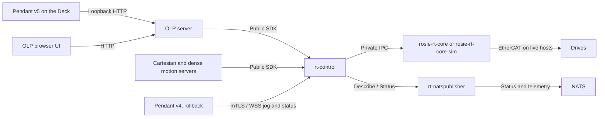

# RosieOS

Software for one Rosie welding cell: the native realtime controller, the
motion servers, the weld planner, offline programming (OLP), the Steam Deck
teach pendant, the bus, the robot descriptions and the deployment tooling.
Check it out onto the operator PC, the Jetson, the RevPi and the Steam Deck.

- **`rt-core` is the only controller source.** The retired v4 daemon, NATS
  command bridge and pair owner are no longer built or selected. Published
  release tarballs remain the rollback path for installed cells.
- **Every consumer drives the robot through the public native control API**
  (`rt-control`). The browser never writes EtherCAT frames.
- **The deploy Go module is `steamdeck/real/v4`.** The new native teach pendant
  is `steamdeck/real/v5`. The v4 pendant's source is gone; a Deck that still
  has it installed keeps it as the rollback.

Each component is its own directory with its own README. Read it before
changing anything there: most carry measured numbers next to their constants.
Working conventions for this repo are in [`CLAUDE.md`](CLAUDE.md); lint and
format checks are in [`CONTRIBUTING.md`](CONTRIBUTING.md).

Qualification starts with a generated plan for each source diff. The plan names
required claims, matching tests, and missing evidence. PR admission reports the
plan in shadow mode. A verified candidate from the build host can then gain
simulation receipts; servo HIL, robot, and welding stages remain separate. Read the
[qualification pipeline](docs/QUALIFICATION-PIPELINE.md) for the contract and
run `node quality/qualification.mjs plan --base origin/main --head HEAD`.
For a supervised motion-free bench install, run the documented `install-inputs`
preflight first. It checks the candidate and prior evidence; it does not
install software or admit motion. The managed release command does not enforce
this preflight yet.


## How a cell is wired



- `rt-control` admits **one controller at a time** under a lease and fence.
  Remote consumers connect over mutual TLS (`:8443`); local ones over a Unix
  socket. Native Home, Arm, Stop and jog use this API; the retired controller's
  mode, pair, Home and physical-I/O commands are refused.
- The v5 pendant never talks to `rt-control` itself. It runs a headless OLP
  server on the Deck (`127.0.0.1:8794`), which owns the machine session.
- Cartesian intent UDP terminates at the Cartesian motion server; it does not
  address the cyclic controller.
- NATS keeps program authority, planner requests and observations. The subject
  `robot/v4/robot.<cell>.command` belongs to the retained program plane. The
  observer publishes `robot/v4/rtcore.<host>.status` and
  `robot/v4/rtcore.<host>.telemetry.batch` (stream `ROBOT_V4_RTCORE`); these
  names are display and archive compatibility, not command authority.

`Motion Server` is the service family and retained NATS protocol name. The
`robot-v4-cartesiand` process is the **Cartesian control daemon**; the dense
trajectory executor (`joint_trajectory_daemon`) is a separate role, not a later
version of it.

## What is in this repo

### Control and motion

| Folder | Role |
| --- | --- |
| [`rt-core`](rt-core/README.md) | Native controller: `rosie-rt-core` (EtherCAT) and `rosie-rt-core-sim`, the `rt-control` adapter, Go SDK (`sdk/control`), header-only C++ client (`clients/cpp`), generated TS types (`clients/ts`), `rtctl`, `benchdrive`, `rt-natspublisher`, host install and systemd units |
| [`rt-core/config`](rt-core/config/README.md) | Drive, robot-binding, machine and cell configuration: `drives/`, `machines/{bench,simulation}/`, `cells/`, `cell-io/`, `templates/` |
| [`robot_description`](robot_description/README.md) | Robot models and their manifests (`rosie_1400_v3`, `rosie_1420_v1`, `rosie_1430_v1`, `bench_one_motor_1to1`, `bench_nine_motors_1to1`) and the `rosieos/robotdesc` Go module. Machine configs pin a description by path and SHA-256. Contract: [`docs/ROBOT-DESCRIPTION-CONTRACT.md`](docs/ROBOT-DESCRIPTION-CONTRACT.md) |
| [`motion-server/v1`](motion-server/v1/README.md) | `robot-v4-cartesiand`: rt-core Cartesian jog, Tesseract planning, accepted-plan playback, position/GoHome execution, and `--resolve-only` for OLP's Cartesian holds |
| [`motion-server/joint-trajectory/v1`](motion-server/joint-trajectory/v1/README.md) | `joint_trajectory_daemon`: dense precomputed trajectory playback (TCP ingest `:8797`) |
| [`tesseract/v1`](tesseract/v1/README.md) | Tesseract / TrajOpt collision environment (pixi). Missing it, classic planning is refused rather than run without collision checks |

### Planning and programming

| Folder | Role |
| --- | --- |
| [`offline-programming/v1`](offline-programming/v1/README.md) | OLP: Go server (`:8794`) plus Vite UI (`:5189`). CAD-to-weld authoring (rails by default), taught MoveJ/MoveL/MoveC waypoints, TCP motion profiles, and direct machine control of a selected cell: Home, Arm, jog, Load, Play |
| `weld_planner/v1` | Pixi project for CAD-to-weld motion. `seam_worker` (rails authoring, run by OLP one subprocess per request), `weld_motion_planner` (CUDA planner, FastAPI on `:8796`), `weldplan` (contracts, dense `.rdt` encoder). Start at `docs/GOAL.md` and `docs/DECISIONS.md` |
| [`cadquery/v1`](cadquery/v1/README.md) | CadQuery STEP topology and tessellation worker used by OLP's STEP import |
| [`mujoco-sim/v1`](mujoco-sim/v1/README.md) | Independent MuJoCo model and A6-EC drive physics tools. Not a controller stand-in |

### Pendant and UIs

| Folder | Role |
| --- | --- |
| [`steamdeck/real/v5`](steamdeck/real/v5/README.md) | Native Qt 5.15 teach pendant `rosie-pendant-v5` for the Deck's 1280×800 screen. Runs OLP's own TypeScript program logic in QJSEngine against a loopback OLP server. Checkpoint: not yet qualified on physical input or real motion |
| [`steamdeck/real/v4`](steamdeck/real/v4/README.md) | Deploy tool (`realtime-core`, `olp`, `camera`, `pendant`): cell releases and rollback, the v5 pendant install, program contracts (`contracts/programs`), read-only legacy archives (`internal/legacyarchive`), offline Home migration (`cmd/home-profile-migrate`) |

### Networking and operations

| Folder | Role |
| --- | --- |
| `coordination/v1` | Fleet Board: Cloudflare Worker + D1 capability map, coordination holds, job queue and tailnet service links. Coordination only; no execution authority |
| [`releases/robot-stack`](releases/robot-stack) | Release specs. `v0.1.0` is the Robot-v4 rollback; `next/` is a draft native rt-core package |
| [`tools/robot-stack-release`](tools/robot-stack-release) | Offline release bundling and verification (`bundle.py`, `prepare.py`) |
| [`quality`](quality/DEPLOYMENT.md) | `quality.mjs` lint/format/typecheck runner, report-only native checks, advisory deployment doctor. See [`CONTRIBUTING.md`](CONTRIBUTING.md) |
| [`cli/v1`](cli/v1/README.md) | `rosie`: the agent-first command line for RosieOS (install: `cli/v1/install.sh`). Verdict-first output, `--json`, exit codes; `doctor` and `status`; OLP programs authored with OLP's own engine in an on-disk workspace (waypoints, STEP parts, seam search, welds, fixtures, plan, save, undo); `program check` (pass/fail in absolute units); `view scene` (3D snapshots from OLP's own renderer in headless Chrome) and HTML reports; cell diagnosis, alarms, events; read-only deploy review; robot actions through OLP only (Stop always; motion only when the target allows, `--sim`, a two-step run confirmation, bounded jogs, a heartbeat keepalive; never Home, fault reset or recover-to-zero). Its `src/lib` is shared with `mcp/v1`. Skills: `.claude/skills/rosie*`, installed for every Claude Code session by `rosie skills install` |
| [`mcp/v1`](mcp/v1/README.md) | `rosieos-mcp-server`: MCP (stdio) for agents, a front end over `cli/v1`'s library (agents are better served by the `rosie` CLI). rt-core observation, OLP status and gated robot actions (Stop always; Arm/Load/Play/Run program and per-call bounded jogs only when `ROSIE_MCP_ROBOT_ACTIONS` allows; never Home, fault reset or recover-to-zero), OLP program authoring through OLP's own engine, dense daemon, Cartesian kinematics, weld planner, cell manifests, `.rdt` inspection, docs, read-only deploy commands |
| [`docs`](docs) | Cross-component contracts (`ROBOT-DESCRIPTION-CONTRACT.md`, `PLANNING-CONTEXT.md`), Nix scope, Deck provisioning, and dated historical records |

### History

The earlier bring-up trees (`robot/v1`–`v10`, `daemon/v2`, `urdf/v2`–`v5`, the
`steamdeck/real/v1`–`v3` Deck demos) and the Fusion-to-URDF tooling were removed
before the open-source release. Robot models live in `robot_description`, with
the sphere tool in `tools/sphere_tool`; `urdf/v1` keeps only the Rosie 1400 v3 viewer copy the
v4 Deck pendant deploys.

## Cells

Approved native cell bindings live in [`rt-core/config/cells`](rt-core/config/cells/README.md);
OLP checks every remote cell it offers against the matching file there.
Configured in this tree: the local simulation and the placeholder
`linear-rail-1axis.json`, the pattern to copy for a new cell.
Installed-cell qualification is a separate owner action.

## Toolchains

None are on `PATH` by default; `rosie` manages them under `~/.rosie`:

```bash
export PATH="$HOME/.rosie/bin:$HOME/.rosie/go-1.26.2/bin:$HOME/.rosie/node-22.13.1/bin:$PATH"
```

Python components are pixi projects (`~/.rosie/bin/pixi`); install with
`pixi install -e <env>` from the component directory and run tests through
pixi, never a hand-built `pip` environment. `weld_planner/v1` environments are
`default` (seam worker), `motion` (linux-64, CUDA ≥ 12), `motion-thor`
(aarch64 Thor) and `bench`.

The root [`flake.nix`](flake.nix) / [`flake.lock`](flake.lock) pin the host
environment for the Motion Server host build and configuration tools; see
[`docs/NIX-BUILD-ENVIRONMENT.md`](docs/NIX-BUILD-ENVIRONMENT.md) for its exact
scope and the separate target-ABI admission requirement.

## Local native simulation

One command starts the whole local stack. It supports only
`DEV_STACK_BACKEND=rt_core` (the default); `legacy_v4`, `sim`, `controller` and
`cell` selections fail before startup.

```bash
./dev-stack.sh start      # or: start <service ...>
./dev-stack.sh status
./dev-stack.sh logs
./dev-stack.sh stop
```

| Service | Listens on | Notes |
| --- | --- | --- |
| `catalog` | `:8787` | Program catalog; skipped if its start script is absent |
| `nats` | `127.0.0.1:14222`, monitor `:18222` | `~/.rosie/bin/nats-server` (`DEV_STACK_NATS_BIN`); skipped if absent |
| `rt-sim`, `rt-control` | Unix sockets | Via `motion-server/v1/local-rt-core.sh`; builds `make -C rt-core control sim` if needed |
| `daemon` | TCP `127.0.0.1:8797` | Dense `joint_trajectory_daemon`; build with `make -C motion-server/joint-trajectory/v1 all` |
| `motion` | `0.0.0.0:8796` | Weld planner, `pixi run -e motion motion-serve` |
| `olp` | `127.0.0.1:8794` | OLP API via `start-offline-programming.sh` |
| `ui` | `:5189` | OLP UI |

Open **`http://127.0.0.1:5189/offline-programming/v1/ui/`** — port 5189, not
8794, which is the API.

- In WSL, set `TMPDIR` to a Linux filesystem (for example
  `/dev/shm/rt-core/local`) and create it first; Unix sockets cannot bind on
  `/mnt/c`.
- Build outputs stay under `rt-core/build`. Pid files and logs live under
  `ROSIE_DEV_STACK_DIR` (default under `XDG_RUNTIME_DIR` or `TMPDIR`).
- `DEV_STACK_OLP_CELLS` merges a cell catalogue into OLP's picker.
- The focused composed smoke is `bash motion-server/v1/tests/dev-stack-smoke.sh`.

### OLP without the full stack

```bash
cd weld_planner/v1 && pixi install -e default && pixi run -e motion motion-serve  # :8796
export OFFLINE_PROGRAMMING_WELD_PLANNER_MOTION_ORIGIN=http://127.0.0.1:8796
bash offline-programming/v1/start-offline-programming.sh                           # :8794
cd offline-programming/v1/ui && npm install && npm run dev                          # :5189
```

The launcher reuses a running dev-stack's rt-core binding or owns its own
simulator and adapter. Read its `rails:` and `motion:` lines: `api health ok`
does not mean rails authoring or planning works. Bare `go run . serve` is not
a supported entry point; it needs the launcher's staged UI and rt-core config.
The [OLP README](offline-programming/v1/README.md) and `CLAUDE.md` list the
remaining traps. The OLP project store is per browser origin, so never clear
site data on `:5189`.

### OLP UI against a robot cell

To run the UI on this Mac against a cell's OLP, one
command starts a self-healing tunnel to the cell's OLP and Vite on `:5189`,
both as launchd agents that outlive the terminal:

```bash
cd steamdeck/real/v4
go run . olp ui start --manifest rt-core/config/cells/<cell>.json   # status | logs | restart | stop
```

Then open `http://127.0.0.1:5189/offline-programming/v1/ui/`. Details:
[`docs/DEPLOY_AND_TEST_WORKFLOW.md`](docs/DEPLOY_AND_TEST_WORKFLOW.md), "The
browser UI against a cell".

Cells → **Search local network** lists the cells other OLP servers advertise
(mDNS `_rosie-olp._tcp` on the interfaces a cell manifest names, and an
advertisement-only listener on the tailnet, port 8798). It is information
only: Add fills the form from this server's commissioning, never the
advertised address. Design and limits:
[Finding cells on the network](offline-programming/v1/README.md#finding-cells-on-the-network).

A Steam Deck pendant on the cell's OLP gets the same tunnel on the Deck,
under systemd --user: `go run . pendant tunnel install|status|logs|restart|stop|rollback
--manifest <cell> --host <deck>` (workflow guide, "The Deck's tunnel to the
cell's OLP").

## Steam Deck pendant v5

```bash
(cd offline-programming/v1/ui && npm ci)
make -C steamdeck/real/v5 -j4 all
make -C steamdeck/real/v5 check
steamdeck/real/v5/package.sh
# install on a Deck with the cell-driven commands (they run deck-install.sh):
(cd steamdeck/real/v4 && go run . pendant install --manifest rt-core/config/cells/<cell>.json --host <deck> --commit <sha>)
```

On the Deck, `run.sh` is the Steam shortcut entry: it starts the OLP server as
the `rosie-v5-olp` user unit, then the app. Planning needs the weld planner
motion server reachable from the Deck. Details, per-Deck site files and what
is not yet qualified: [`steamdeck/real/v5/README.md`](steamdeck/real/v5/README.md).
Deck provisioning for the v4 client: [`docs/steamdeck-provisioning.md`](docs/steamdeck-provisioning.md).

## Deploying to a robot

Deploys are owner-operated, run from `steamdeck/real/v4` on the operator Mac,
and driven by the cell manifest. Use the smallest tier that carries the change;
`realtime-core release` picks it and runs it. How to use the commands (tiers,
fast and full tests, the cell lock and maintenance notice, tuning a joint, the
pendant, rollback, troubleshooting):
[`docs/DEPLOY_AND_TEST_WORKFLOW.md`](docs/DEPLOY_AND_TEST_WORKFLOW.md). Each
tier's procedure and refusals are in
[Deployment tiers](steamdeck/real/v4/README.md#deployment-tiers); this is the
summary.

| Tier | Carries | Commands | Duration (a Rosie 1430 cell) |
| --- | --- | --- | --- |
| Configuration-only | values in `rt_core.machine_config` the installed rtctl already understands | `realtime-core config` | 35.5–36.9 s per apply |
| OLP-only | OLP server, UI, Cartesian resolver; protocol and capabilities digest unchanged | `realtime-core build --test`, then `olp install` | fast gate plus a 5.5-7.2 s install. Released whole: 17m24s and 14m03s (13m19s of it the gate) before the fast gate skipped suites a recorded pass covers; with that skip an OLP-only change is ~1.5 min (dry-run estimate) |
| Full rt-core package | native code, protocol, rtctl, drive profiles, robot descriptions, units | `realtime-core build --test --fetch-package`, then `deploy --package` and `start`, then `verify`; then OLP-only | full gate (~11.5 min; reused on a retry) plus ~45 s to install, start, verify and install the OLP; one full `release` took 24m44s, 9m22s of it waiting for the lock |
| Steam Deck v5 rebuild | pendant, its `olp-core.js`, meshes; any capabilities digest change | `pendant build`, then `pendant install --host <deck>` | build 218 s fresh, 23 s incremental (Mac), 54.9 s incremental with the builder image rebuilt; install 5.3 s; separate owner approval |

The most common commands, for one cell:

```sh
cd steamdeck/real/v4
CELL=rt-core/config/cells/<cell>.json
go run . realtime-core release --manifest $CELL --commit <sha> --plan   # read-only: tier and steps
go run . realtime-core release --manifest $CELL --commit <sha>          # lock, build, test, deploy, verify, timings
go run . realtime-core precheck --manifest $CELL      # read-only: disarmed, no lease, OLP idle, dumps copied
go run . realtime-core copy-dumps --manifest $CELL    # Stop dumps off the servo host before any restart
go run . realtime-core config --manifest $CELL --dry-run   # then --accept-configuration <printed sha256>
go run . realtime-core build --manifest $CELL --test  # builds HEAD into a tree on the relay; installs nothing
go run . olp install --manifest $CELL --deployment <commit>
go run . realtime-core verify --manifest $CELL        # read-only acceptance after a start
```

A release run again for the same commit resumes where it stopped (units
stopped: start; running: verify; then the OLP), reuses a test gate that
already passed for that commit (`--regate` runs it again), starts once more
after a stalled bus bring-up before rolling back, and prunes old servo
releases last. `realtime-core deploy` installs the relay-built package
(`--package`); the old build-peer path is `--legacy-build-peer`.

Every command takes `--dry-run` (prints the scripts, contacts nothing; only
`realtime-core config --dry-run` is a read-only probe of both hosts), prints
`[elapsed +step]` progress lines, ends with a timing table and keeps a
transcript in `~/.rosie/deploy-journal/` (`realtime-core timings` prints the
history). `go run . realtime-core --help`, `go run . olp --help` and
`go run . pendant --help` list the rest; `<command> --help` lists a
command's flags.

- The robot is disarmed with no lease held; commands that stop anything wait
  for idle (`--idle-wait`, `wait-idle`) and refuse an armed, enabled or leased
  controller.
- Commands that touch the robot or restart the OLP put up the maintenance
  notice: every OLP browser and Deck shows a blocking overlay and refuses robot
  actions; `maintenance clear` removes one a dropped connection left behind.
- Building, testing or updating on a cell's hosts and using its robot are
  mutually exclusive: `realtime-core build` and any other job there
  (`realtime-core lock --reason ... -- <command>`) wait for the robot to be
  idle, hold the notice while they run and clear it after
  ([Cell lock](steamdeck/real/v4/README.md#cell-lock-building-testing-and-using-the-robot-are-exclusive)).
  Builds and tests off the cell need no lock.
- Never decode telemetry on the RevPi: a decode there stalled EtherCAT and
  invalidated Home. `copy-dumps` copies throttled; decode elsewhere.
- Copy Stop dumps off before any rt-core restart: a restart deletes
  `/run/rosie-rt-core`, dumps included.
- A servo host reboot needs the owner's approval, even disarmed:
  `realtime-core reboot --owner-approved --reason "<what the owner approved>"`,
  then `resume-after-reboot`. Nothing else reboots.

A new cell needs a `cell_deploy` block in its manifest first:
[Adding a new robot cell](steamdeck/real/v4/README.md#adding-a-new-robot-cell).

## CI

| Workflow | Gates |
| --- | --- |
| `rt-core.yml` | rt-core native tests, sanitizer run, IgH live build and runtime package |
| `rt-core-consumers.yml` | Cartesian, dense, local-simulation, v4 pendant, OLP and deployment consumers: authority, Stop, package closure, obsolete-selection refusals |
| `weld-planner-verifier.yml` | Dense export admission, verifier contract, `sphere_tool` build |
| `weld-preflight-adapter.yml` | The weld planner's adapter for the pinned Weld Preflight wheel |
| `quality-pilot.yml` | `quality.mjs check` and actionlint |
| `pr-admission.yml` | Always-running, path-aware pull request admission result |
| `deployment-surface.yml` | Advisory deployment-surface diff (non-blocking) |
| `ci-gate-start.yml`, `ci-gate.yml` | `CI gate` commit status, recomputed as each PR run completes: fails when a run failed, or a path-filtered workflow matched the change but did not start or skipped every job; warns on code no test workflow covers (report-only) |

No workflow builds or tests `steamdeck/real/v5` yet. Linters and CI do not
prove installation, controller admission or physical execution.

### Pull request admission trial

`PR admission / required` runs for every pull request. The versioned policy is
[`quality/pr-admission-policy.json`](quality/pr-admission-policy.json).

The gate is in shadow mode. A green job means the gate produced a complete
report. Read the job summary to see whether enforcement would admit the change.
Runtime areas with no exact proof mapping report `proof mapping pending`.
Unknown paths fail closed in the reported verdict.
The first matching policy rule owns each changed path. Put narrow rules before
broad rules.

Run the same selector and checks locally:

```bash
node quality/pr-admission.mjs run --base origin/main --head HEAD
```

The runner stores no shell commands in policy data. Check identifiers resolve to
fixed commands in [`quality/pr-admission.mjs`](quality/pr-admission.mjs).
This keeps pull request code from changing a policy string into an arbitrary
command without changing the reviewed runner.

## Not in this repository

There is no root `rosie` dispatcher, `go.mod` or `go.work`. Run each component
through its own scripts, Makefiles, `go run .` inside its module, Cargo or pixi;
the component READMEs give the commands. `nats-server` (v2.14 or later) is an
external binary; dev-stack looks for it at `~/.rosie/bin/nats-server`. The networking operators use to reach a cell's hosts (a
Tailscale mesh and SSH access) is site setup, not part of RosieOS, and is not on
the motion path.

## License

Copyright 2025-2026 Gradient Industrial Robotics Corporation, doing business as
Advanced Metal Research. Licensed under the [Apache License, Version 2.0](LICENSE);
see [`NOTICE`](NOTICE). Third-party material (vendor drive manuals and device
files, an embedded IgH script) keeps its own license or terms
and is not covered by the Apache License: [`THIRD_PARTY_NOTICES.md`](THIRD_PARTY_NOTICES.md).
