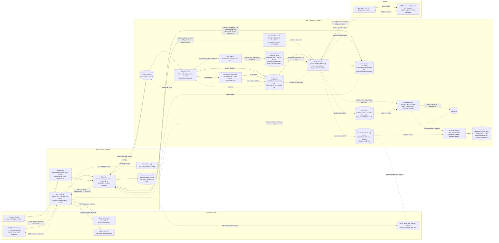
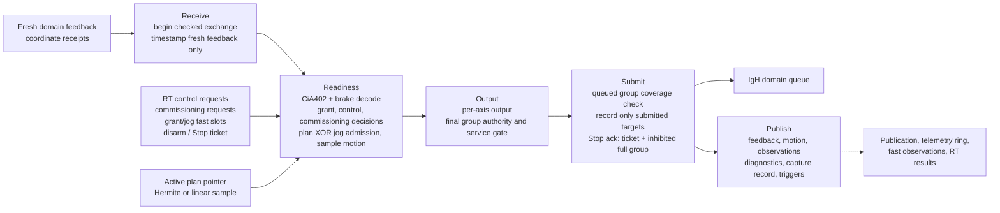

# Current architecture

## A6-EC absolute linear coordinates (P8-45)

Every A6-EC axis uses absolute linear mode (`C00.07 = 1`). The drive reports and
accepts one continuous signed count number line; rt-core applies the
robot-definition motor-to-axis ratio in software and pins the standard drive
gear ratio `0x6091:01/02` to `1/1`. The profile-declared independent source is
the raw multi-turn counter with identity `raw_multi_turn_encoder|3`. HM35 writes
`607C = 0`; the rest of the fixed transaction is unchanged.

Coordinate observation, Home, retained Home and verified-delta compare complete
count values exactly. No layer folds a command, unwraps feedback, chooses a
nearest turn or accepts a modulo-equivalent source. Rotation mode, wrapped
command/feedback paths and batteryless single-turn mode 3 are removed. The
public `feedback_wrap`, `command_wrap` and `anchor_period_counts` fields are
removed with their generated clients and consumer branches.

This is a release contract, not hardware evidence. The branch does not merge
until the mini bench proves mode-1 continuity, HM35 zero, multi-turn reversal,
Stop, power-cycle retention and battery-failure refusal at servo rate and the
first cell to migrate is ready. Each migrated cell then requires an
owner-approved full release and operator HM35 on every joint. Final generated
capability/configuration digests
and implementation-specific citations are intentionally deferred until the
concurrent code changes settle.

2026-10-01 Go remote-hold follow-up: the SDK's existing refusal reader also
consumes matched two-message clock-refresh replies while caller updates continue.
Refresh begins after half the input lifetime; its second source sample follows
receipt of the first reply. It carries no motion input and cannot renew source
deadlines or reopen expired generations. OLP drops a contended unsent sample
instead of ending the hold, while native expiry remains authoritative. No
controller motion limit, homing transaction or clock qualification bound changes
in this implementation.

2026-10-02 current-pose reference removal: the software current-pose zero
introduced on this branch (`capture_current_reference`, native command 266,
the `reference_capture` axis policy, `rosie-anchor-v5` receipts and their
compiler, SDK, OLP and test support) is deleted, not stubbed. Home is
established only by drive homing (HM35), which writes 607C; rt-core records the
HM35 position as a v3 anchor for check and backup. That anchor is restored
automatically after a power cycle by direct drive checks, by `RestoreAnchor`,
or by verified-delta restore (command 267) for v3 only. A remaining
`rosie-anchor-v5` file is refused, untouched, as `anchor_source_invalid`:
"current-pose reference anchors are not accepted; establish Home with drive
homing (HM35)". A configuration declaring `reference_capture` no longer
compiles or loads, so trial configurations that opted J6 in cannot be
reproduced byte-for-byte; their entries below remain historical evidence only.
Software never routes around a drive or hardware failure (for example a drive
that fails HM35): the failure is surfaced and fixed at the drive.

P3-08: consuming a C++ streaming reservation wakes its existing connection keeper;
the command path still requires a warm socket. Non-RT jog observation retries only
busy snapshot reads (three attempts maximum), never stale/invalid evidence or an
old cached value.

Persistent Home calibration and live position confidence have separate RT-owned
state. The independent battery-backed multi-turn path binds from a matching saved
offset/identity and fresh stationary absolute evidence, then tracks continuous
PDO displacement. A failed/torn background read is diagnostic only. Coherent
stationary contradictions, encoder alarms and cyclic continuity failures lose
position trust and retire motion authority while retaining calibration.
Read-only recovery may restore trust with a fault still latched; Reset and Arm
remain explicit. Home sequencing and the 50-count stationary margin are unchanged.
The old profile provenance text describing a running sample lease is superseded
by this contract. Profile bytes are retained because their source hashes enter
the compiled configuration identity; acquisition age/duration fields still bound
Home/recovery reads and history allocation.
Release is blocked until the affected PDO/drive reset and turn-loss coverage is
qualified. An inhibited bench deployment recovered all six axes at
nonzero positions without Home. Finite telemetry batches negotiate HTTP gzip in
the adapter, outside the real-time loop; Chrome 1 kHz capture passes. Physical
execution acceptance is outstanding.

Owner-operated external Chrome execution subsequently completed: revision 14,
48.071 s, zero faults, six trusted positions. Full 1 kHz run samples were not
preserved before ring rollover; reset/turn-loss and repeat/restart gates remain open.

OLP Go to plan start reuses its synchronized joint-move lane with absolute
endpoints from the selected plan's first sample. Fresh native held state supplies
the origin; existing native admission and Stop apply. See
[OLP execution](../../offline-programming/v1/docs/RT_CORE_EXECUTION.md).

An acknowledged, submitted Reset retires its SDK session even when native Reset
refuses. Clearing only the matching session/generation lets fresh acquisition
and renewal use the new grant; uncertain or unsubmitted requests retain recovery
authority. The bench bare-motor rev14 trajectory now passes with measured J6 drive
feedforward tuning.

SDK telemetry capture uses two independent read-only HTTP reservations, outside
the control slots reserved by acquisition preparation. A held capture body cannot
block Arm preflight.

Retained-Home startup recovery now qualifies the drive's saved offset/Home state
against the existing software anchor and current absolute encoder/PDO relation,
allowing normal movement since calibration. It restores axes independently while
disabled, with no Home sequence or motion.

2026-09-23 tracking correction: the output policy compares fresh feedback against
the last successfully submitted wire target, before considering the current
candidate for submission. Tracking thresholds and Home sequencing are unchanged.
OLP reconstructs recorded TCP paths separately from the visible robot using
qualified continuous coordinates and recorded Home/configuration identity; gaps
remain gaps.

Source commit: `e73174840bda259cdcb53f9a68de19fb5ce1735a`.
Source citations below use paths relative to `rt-core` and line numbers at that commit.
Read the [implemented API](APPLICATION_API.md), [connection overview](DATAFLOW.md),
[telemetry ring contents](TELEMETRY_RING.md),
[configuration layers](../config/README.md), [backlog](IMPLEMENTATION_PLAN.md),
tracker and [historical records](history/README.md) alongside this document.

Current-only application observations may request `/v1/status?view=control`.
The Go adapter skips constructing historical handles while holding its mutex;
the public full-status/history route remains available. Current native evidence
and freshness policy are identical. OLP preserves full handle receipts for
joint moves and fences late compact responses from their shared observation.

## Processes and sockets

The C++ daemon constructs one `MachineState`; its composition starts the cyclic,
telemetry-writer and publisher threads, and the connection setup starts the helper and
bulk workers for the admitted connection. The commissioning worker is started by the
machine itself. [src/main.cpp:173](../src/main.cpp#L173), [src/main.cpp:47](../src/main.cpp#L47),
[src/main.cpp:138](../src/main.cpp#L138), [engine/cycle_machine.hpp:1398](../engine/cycle_machine.hpp#L1398).
The separate Go `rt-control` process owns the public HTTP and jog listeners and
connects to native IPC. [cmd/rt-control/main.go:63](../cmd/rt-control/main.go#L63).

The dense trajectory consumer lives in `motion-server/joint-trajectory/v1`; its
`rt_core` backend uses the public C++ SDK. The separate Cartesian owner remains
`motion-server/v1`. Cartesian pendant motion must be converted there to joint
velocities before entering rt-core's public jog lane. The path jog lane
(protocol 1.14) is the straight-line alternative: the producer streams joint
positions of its path (OLP: seeded IK every 1 mm) through an acknowledged
`path_samples` fast slot, and `JogLane` in path mode feeds one `PathJog`
owned by the machine object, whose single jerk-limited path speed drives
every masked axis; End, Halt and expiry stop along the path. rt-core holds no
kinematics for it ([CONTRACTS.md](CONTRACTS.md#path-jog-lane-protocol-114-2026-10-07)). rt-core performs joint-space
execution only. `robot/v4/realtime-core` and the legacy realtime-core selections were
retired by P8-11 (`01a2ee4b`).
Installed releases keep their rollback slot; branch source is native only.

Tracking and jerk, 2026-10-06 (contracts in [CONTRACTS.md](CONTRACTS.md)):
a jog or Halt target leading feedback beyond `max_target_lead` is a journal
warning, not a fault; following error stays the hard tracking fault. Both
bounds grow by |commanded velocity| x the machine-level
`tracking_lag_allowance` (`speed_scaled_bound`, one time for every joint).
Drive speed feedforward is drive configuration (A6-EC C01.13/14/15 startup
keys), because the A6-EC ignores 0x60FF in CSP. The machine-level `jog_jerk`
adds a native `JogSmoother` (W-cycle mean of the acceleration-limited
integrator) to joint jog and Halt ramps; path jog targets bypass it, and OLP
uses the compiled value (`rtctl.Compiled.JogJerk`) for Move-to and Cartesian
steps. None of these values is in Describe (which advertises `path_jog` only
when `jog_jerk` is set); all are machine identity, none coordinate identity, so
changing them keeps Home anchors valid.

Machine configuration may omit servo-tuning
startup keys to retain drive-held values. The deploy
tool permits removal only for keys classified as tuning in the new compiled
catalog. No native write path or public API changes: omitted keys produce no
startup writes, while structural startup settings and readiness checks remain.
This source change is not deployed and does not restore previously overwritten
tuning. See [the tuning contract](CONTRACTS.md#per-joint-drive-tuning-and-observe-only-reads-2026-10-07).

OLP derives a connected planning context from the verified robot description,
calibration and fresh native limits in Describe. It intersects the envelopes
before trajectory generation and separates planner caches by the native limit
snapshot. An unavailable selected target blocks planning. Prepare remains the
final admission authority; its optional numeric limit refusal evidence flows
through the SDK to the OLP message without changing the admission decision.
See [the planning context](../../docs/PLANNING-CONTEXT.md).

For URDF-mapped robot axes, the compiler derives travel and maximum velocity
from the robot URDF and both execution/jog acceleration from the registered
robot config's per-joint acceleration. A machine cannot redeclare these motion
limits. The A6 drive profile supplies no acceleration cap; a bench cell inherits
the selected robot's parameters. Standalone motor fixtures without a robot URDF
retain their explicitly configured fixture rates.
The drive-frame speed register is derived per axis from URDF velocity, robot
gearing, and encoder scaling. Mapped robot machines cannot supply a separate
motor-RPM cap. Hardware encoding constraints reject unsupported values.

The diagnostic publisher retains `robot/v4/rtcore.<host>.status` and
`robot/v4/rtcore.<host>.telemetry.batch`. Main's motion-server
`.joint-telemetry` publication is a separate subject, not a rename of either.
Unavailable legacy pair-authority fields remain unavailable; diagnostic NATS
observations cannot substitute for an authenticated rt-control grant.
[publisher.go:381](../tools/natspublisher/publisher/publisher.go#L381),
[payload.go:43](../tools/natspublisher/publisher/payload.go#L43),
[host/rosie-rt-natspublisher.service:27](../host/rosie-rt-natspublisher.service#L27).

| Surface | Implemented topology and trust boundary | Source |
|---|---|---|
| Local control and bulk | HTTP over Unix `control.sock`; the installed public name links to `public/control.sock`. The adapter binds mode 0660. | [host/rosie-rt-core.service:24](../host/rosie-rt-core.service#L24), [cmd/rt-control/main.go:83](../cmd/rt-control/main.go#L83) |
| Local jog | Unix datagram `jog.sock` beside the bound control socket; the installed public name links to `public/jog.sock`. Filesystem access and the current unpredictable session token gate admission. | [host/rosie-rt-core.service:26](../host/rosie-rt-core.service#L26), [adapters/rosie/control/jog_linux.go:242](../adapters/rosie/control/jog_linux.go#L242) |
| Private native IPC | Installed daemon and adapter use `/run/rosie-rt-core/native/ipc.sock`; the native directory excludes ordinary application clients. The standalone adapter CLI and `host/run-core` still default to the older `/run/rosie-rt-core/ipc.sock`, so standalone launches must supply the intended path. WELCOME hands the adapter five descriptors: command ring, status ring, their two eventfds and the fast region. | [host/rosie-rt-core.service:22](../host/rosie-rt-core.service#L22), [host/rosie-rt-control.service:20](../host/rosie-rt-control.service#L20), [cmd/rt-control/main.go:26](../cmd/rt-control/main.go#L26), [engine/ipc_transport.hpp:721](../engine/ipc_transport.hpp#L721) |
| Remote control and bulk | Optional TCP listener, disabled by an empty `--remote-listen`; TLS 1.3 with required verified client certificates. The existing HTTP handler serves control, bulk, status and events. | [cmd/rt-control/main.go:33](../cmd/rt-control/main.go#L33), [adapters/rosie/control/remote_tls.go:130](../adapters/rosie/control/remote_tls.go#L130), [adapters/rosie/control/remote_listener.go:124](../adapters/rosie/control/remote_listener.go#L124) |
| Remote jog | Dedicated WSS upgrade on `/v1/jog`, bound to the principal that acquired the grant; two timestamp exchanges precede binary jog updates. Local GET on that path remains JSON status. | [adapters/rosie/control/remote_listener.go:137](../adapters/rosie/control/remote_listener.go#L137), [adapters/rosie/control/jog_ws.go:130](../adapters/rosie/control/jog_ws.go#L130), [adapters/rosie/control/http.go:71](../adapters/rosie/control/http.go#L71) |
| Remote identity | Component CA, `rosie-principal:<id>` and matching `rosie-pair:<pair-id>` URI SANs; current signed CRL checked during handshakes. Changed certificate/key/CRL files are reloaded for full handshakes. | [adapters/rosie/control/remote_tls.go:21](../adapters/rosie/control/remote_tls.go#L21), [adapters/rosie/control/remote_tls.go:50](../adapters/rosie/control/remote_tls.go#L50) |

Native bootstrap checks role, kernel UID and adapter HELLO PID. The configured
adapter UID may differ from the daemon UID; old same-UID-only descriptions are
superseded. [include/peer_admission.hpp:19](../include/peer_admission.hpp#L19).
Heartbeat, disarm and ticketed urgent Stop packets are read by the main socket
owner independently of the helper. [src/main.cpp:73](../src/main.cpp#L73).

## Data and control flows

Solid arrows are control: requests, jobs, decisions and setpoints that can change
what the drives do. Dotted arrows are data: feedback, receipts and observations
that report what happened and grant no authority on their own. Every path into
the drives passes the cyclic owner; nothing in the adapter or publisher writes
process data directly. Cited owners are the same as in the tables that follow.

Within one cycle the phases below run in order; the arrows show which inputs each
phase may consume and what it hands on. Acceptance happens in Readiness, authority in
Output, and only a checked full-group submission is recorded. Publication and capture
follow submission and never precede it.

## Cyclic owner and phases

`MachineState` owns the cyclic state. `step` has injected bus, clock and phase
observation seams; the phase enum describes execution order rather than a public
motion-mode enum. [engine/cycle_machine.hpp:286](../engine/cycle_machine.hpp#L286),
[engine/cycle_machine.hpp:1644](../engine/cycle_machine.hpp#L1644).

| Phase | Work and acceptance boundary | Source |
|---|---|---|
| Receive | Begin the checked full-group exchange; timestamp only fresh domain feedback and advance its coordinate receipt. Loss after bus readiness clears configuration/home evidence and latches readiness failure. | [engine/cycle_machine.hpp:1814](../engine/cycle_machine.hpp#L1814) |
| Readiness | Decode CiA402 and brake feedback, apply grant/control/commissioning decisions, admit mutually exclusive plan or jog execution, and sample motion. | [engine/cycle_machine.hpp:1874](../engine/cycle_machine.hpp#L1874), [engine/cycle_machine.hpp:2322](../engine/cycle_machine.hpp#L2322), [engine/cycle_machine.hpp:2566](../engine/cycle_machine.hpp#L2566) |
| Output | Derive per-axis output, then apply the final group authority and service gate before queuing. | [engine/cycle_machine.hpp:2687](../engine/cycle_machine.hpp#L2687), [engine/cycle_machine.hpp:3246](../engine/cycle_machine.hpp#L3246) |
| Submit | Check queued group coverage and send result; record only submitted targets. Stop acknowledgement requires the captured ticket and inhibited full-group submission. It does not prove drive receipt, physical standstill or brake engagement. | [engine/cycle_machine.hpp:3304](../engine/cycle_machine.hpp#L3304), [engine/cycle_machine.hpp:3315](../engine/cycle_machine.hpp#L3315) |
| Publish | Publish feedback, motion and bounded observations after submission. | [engine/cycle_machine.hpp:3596](../engine/cycle_machine.hpp#L3596) |

The native backend consumes each preceding successful submission once; cached
domain state cannot establish a new exchange. [include/cycle_bus.hpp:137](../include/cycle_bus.hpp#L137).
Start readiness checks include fresh enabled axes, coordinates, configuration,
home and continuity. Preparation alone does not permit motion.
[include/motion_readiness.hpp:91](../include/motion_readiness.hpp#L91),
[engine/trajectory_store.hpp:98](../engine/trajectory_store.hpp#L98).

## Workers, queues and publication

Queue sizes below are the declared capacities, not measured scheduler guarantees;
the source labels worker sizing unverified. SPSC queues use fixed arrays with
monotonic read/write counters. [engine/cycle_machine.hpp:1338](../engine/cycle_machine.hpp#L1338),
[engine/publication.hpp:10](../engine/publication.hpp#L10).

| Owner | Input, output and blocking boundary | Source |
|---|---|---|
| Main/socket owner | Accepts one controlling connection; receives heartbeat and urgent packets; shuts down a failed connection before joining its workers. | [src/main.cpp:60](../src/main.cpp#L60), [src/main.cpp:122](../src/main.cpp#L122) |
| Helper | Drains bounded IPC records and publishes receipts. Dispatches slow mailbox and bulk jobs instead of executing them in the command drainer. | [engine/helper_worker.hpp:4](../engine/helper_worker.hpp#L4), [engine/helper_worker.hpp:98](../engine/helper_worker.hpp#L98) |
| Commissioning | One admitted job; job queue 1, job receipts 64. RT request/receipt queues each 8; home-truth readback queue 32. Captured generations/epochs must match before mailbox work; cancellation removes RT permission and never releases a blocked operation. | [engine/cycle_machine.hpp:608](../engine/cycle_machine.hpp#L608), [engine/cycle_machine.hpp:1340](../engine/cycle_machine.hpp#L1340), [engine/cycle_machine.hpp:1376](../engine/cycle_machine.hpp#L1376), [engine/commissioning_worker.hpp:158](../engine/commissioning_worker.hpp#L158) |
| Bulk | Job queue 1,024, result queue 256; claims Writing storage, decodes and validates there, then publishes an immutable preparation. | [engine/cycle_machine.hpp:1342](../engine/cycle_machine.hpp#L1342), [engine/bulk_worker.hpp:5](../engine/bulk_worker.hpp#L5), [engine/trajectory_store.hpp:71](../engine/trajectory_store.hpp#L71) |
| RT controls/results | Control request/result queues each 8; RT command result queue 64. These transfer decisions and receipts between owners. | [engine/cycle_machine.hpp:630](../engine/cycle_machine.hpp#L630), [engine/cycle_machine.hpp:755](../engine/cycle_machine.hpp#L755) |
| Publisher | Copies observations and formats status off-cycle; owns master/slave diagnostic queries. Diagnostic records are enqueued on the cycle, formatted off-cycle and drained here, with an exact drop counter. | [engine/status_publisher.hpp:80](../engine/status_publisher.hpp#L80), [engine/status_publisher.hpp:583](../engine/status_publisher.hpp#L583), [engine/diagnostics.hpp:59](../engine/diagnostics.hpp#L59), [engine/diagnostics.hpp:64](../engine/diagnostics.hpp#L64), [engine/diagnostics.hpp:71](../engine/diagnostics.hpp#L71) |
| Telemetry ring and capture drain | Every cycle copies the held torque/validity, coordinate evidence, watchdog counters/peaks, drive/extended diagnostics, output velocity, motion, authority, fault, submission, jitter and configured cell I/O words into CycleCaptureRecordV2, then writes that full record into a single-writer prefaulted memfd ring (seqlock stamps, monotonic index, overwrite counter; default window 100,000 ms; measured V2 geometry is a 272-byte group prefix plus 288 bytes/axis, so nine axes at 1 kHz use 287,204,096 bytes by default (861,604,096 bytes at 300,000 ms), declared separately in the resident budget). Triggers (fault latch, Stop, session-authorised mark_telemetry, exit) are coalesced per publisher pass and written by a dedicated SCHED_BATCH writer in bounded chunks to `runtime/telemetry/<utc>-<trigger>.bin` plus an index; at most one dump pending, further storms recorded as skipped; retention by count (20) and bytes (536,870,912, unverified). The 512-record commissioning capture and `cycle-capture.jsonl` remain as the bounded subset; `rtctl telemetry dump-to-jsonl` renders a dump with the same field names. A read-only descriptor handoff socket lets a separate service user read the live ring. | [engine/cycle_capture.hpp:100](../engine/cycle_capture.hpp#L100), [engine/cycle_capture.hpp:217](../engine/cycle_capture.hpp#L217), [tests/cycle_capture_tests.cpp:114](../tests/cycle_capture_tests.cpp#L114), [include/daemon_options.hpp:254](../include/daemon_options.hpp#L254), [include/daemon_options.hpp:263](../include/daemon_options.hpp#L263), [engine/status_publisher.hpp:493](../engine/status_publisher.hpp#L493), [engine/status_publisher.hpp:148](../engine/status_publisher.hpp#L148) |
| Go observation/events | Adapter emits observed changes into a 256-event ring; polling/SSE batches contain at most 64 records and expose overwritten sequence ranges. It does not retain a queue per subscriber. | [adapters/rosie/control/events.go:19](../adapters/rosie/control/events.go#L19), [adapters/rosie/control/events.go:48](../adapters/rosie/control/events.go#L48) |

The fast native region has independent grant request/observation and jog
control/update/observation slots. Atomic publication gives latest-value jog a path
outside the bulk/helper FIFO; invalid input cannot refresh an old deadline.
[protocol/control.json:12](../protocol/control.json#L12),
[adapters/rosie/control/jog_linux.go:257](../adapters/rosie/control/jog_linux.go#L257).
The diagnostic ring holds 10,800 records: a conservative 27 records per cycle
at a 250,000 ns cycle over a 100,000,000 ns publisher interval. Overflow remains
observable; the service interval is unverified.
[engine/diagnostics.hpp:47](../engine/diagnostics.hpp#L47).

## Authority and identities

| Identity or fence | Implemented meaning | Source |
|---|---|---|
| Application grant | Adapter owns one unpredictable session, generation and pair binding. Acquire/Renew mirror its capability and absolute host-monotonic deadline natively. The lease cap is the daemon option `--control-max-grant-lease-ns` (default 500,000,000 ns, unverified ceiling 10,000,000,000 ns), published by Describe as `max_grant_lease_ns`; Acquire negotiates `requested_lease_ms` within it. Heartbeats alone do not create an application grant. | [adapters/rosie/control/controller.go:509](../adapters/rosie/control/controller.go#L509), [adapters/rosie/control/controller.go:658](../adapters/rosie/control/controller.go#L658), [engine/application_grant.hpp:94](../engine/application_grant.hpp#L94), [include/daemon_options.hpp:1215](../include/daemon_options.hpp#L1215), [adapters/rosie/control/controller.go:25](../adapters/rosie/control/controller.go#L25) |
| Native connection/generation | Connection changes, Stop and revocation fence old work. Retired mappings are kept until RT readers quiesce. | [src/main.cpp:63](../src/main.cpp#L63), [include/rt_mapping_handoff.hpp:9](../include/rt_mapping_handoff.hpp#L9) |
| Incarnations | Daemon startup obtains random incarnation bytes; adapter restart/reconnect invalidates old sessions and reports the new native incarnation. | [src/main.cpp:27](../src/main.cpp#L27), [adapters/rosie/control/controller.go:187](../adapters/rosie/control/controller.go#L187) |
| Configuration/home epochs | Commissioning captures native, configuration and home generations; stale worker completion cannot establish current Home. Coordinates carry identity, acquisition and anchor serial evidence. | [engine/cycle_machine.hpp:1376](../engine/cycle_machine.hpp#L1376), [include/coordinate_evidence.hpp:14](../include/coordinate_evidence.hpp#L14) |
| Machine digest | Daemon reconstructs effective machine fields, verifies the supplied machine artifact/digest and publishes `machine_sha256`. Includes derived units and limits. | [include/configuration_identity.hpp:274](../include/configuration_identity.hpp#L274), [include/daemon_options.hpp:1847](../include/daemon_options.hpp#L1847) |
| Deployment digest | `deployment_sha256` describes host/NIC/CPU/socket/pair/user deployment separately. A supplied digest is checked for valid syntax; native does not reconstruct all externally supplied deployment fields. | [include/daemon_options.hpp:1859](../include/daemon_options.hpp#L1859), [protocol/application-v1.schema.json:3](../protocol/application-v1.schema.json#L3) |
| Compatibility binding | `configuration_sha256` remains in the API. Pair ID/revision must match; a provided `machine_sha256` selects machine binding, otherwise configuration digest equality is required. | [adapters/rosie/control/controller.go:499](../adapters/rosie/control/controller.go#L499) |
| Jog generation/clock | Begin/End fence the jog session. Updates require the current session, clock incarnation, increasing source sequence and original expiry. The input-age ceiling is the daemon option `--control-max-jog-input-age-ns` (default 250,000,000 ns), published as `max_jog_input_age_ns`. Remote calibration bounds clock offset and rejects unqualified mappings; the mapping is qualified only when all three `--remote-jog-*` flags are non-zero, so under default flags every remote calibration is refused with `jog_clock_unqualified` (P0-10). | [adapters/rosie/control/jog_linux.go:257](../adapters/rosie/control/jog_linux.go#L257), [adapters/rosie/control/jog_linux.go:146](../adapters/rosie/control/jog_linux.go#L146), [include/daemon_options.hpp:1216](../include/daemon_options.hpp#L1216), [adapters/rosie/control/jog_clock.go:78](../adapters/rosie/control/jog_clock.go#L78), [cmd/rt-control/main.go:38](../cmd/rt-control/main.go#L38), [adapters/rosie/control/jog_clock.go:300](../adapters/rosie/control/jog_clock.go#L300) |

Stop retires preparations and inhibits; concurrent Stops join one flight, and
Release joins that cancellation before relinquishing the session. Renew during
Stop is a local keepalive with `stopping: true`, not new native permission.
[adapters/rosie/control/controller.go:1144](../adapters/rosie/control/controller.go#L1144),
[adapters/rosie/control/controller.go:655](../adapters/rosie/control/controller.go#L655).
Halt retires the active source after native admission while retaining the grant;
Stop revokes independently and never waits for a ramp.
[adapters/rosie/control/halt_linux.go:13](../adapters/rosie/control/halt_linux.go#L13).

## Coordinates, motion and faults

The cyclic jog path governs the requested velocity vector before integrating
any axis. `jog_position_scale` uses the signed continuous Home command frame and
remaining acceleration-bounded stopping distance. A common
scale reserves the next interval and a wire-count rounding margin; EndJog/Halt
can then decelerate without crossing the position bound. Position governing
reports the existing Limited observation and retains trusted Home/enable.
It does not alter prepared trajectories or relax the final output fault guards.
Simulation qualification is recorded in the 2026-09-22 J9 limit repair record;
physical stopping qualification remains machine-specific.

Logical rotary coordinates use radians and linear coordinates use metres;
conversion includes counts per unit, gearing, sign and home offset. Raw PDO
position and continuous logical position have different validity requirements.
[include/coordinate_model.hpp:30](../include/coordinate_model.hpp#L30),
[include/coordinate_model.hpp:79](../include/coordinate_model.hpp#L79).
Continuous feedback needs qualified exact acquisition/displacement evidence;
source loss, identity change, count disagreement and overflow fail closed.
Persisted anchors are written by temporary file, fsync, rename and directory sync.
Files remain0600unless the deployment explicitly provisions a dedicated
setgid2750adapter-write/native-read directory; then files are0640 so the
independent native reader can validate them across service identities.
The A6 profile declares its bracketed independent raw multi-turn source
(`0x2040:21/23`, source identity `raw_multi_turn_encoder|3`).
Qualified stationary Home or a matching persisted anchor establishes its fixed
origin relative to continuous PDO coordinates. Ordinary observation never
refits or periodically aligns that origin: every complete signed-count
disagreement invalidates Home and stops execution. Old rotation-mode and
single-turn source anchors fail identity validation.
A separate fresh-source recovery mask may clear only a coordinate-reference fault
while stopped and disabled; it cannot establish Home or authorize motion.
Public `independent_anchor_source` proof describes this acquisition separately
from coordinate/Home validity. Explicit anchor restore may use fresh proof to
offer an existing matching anchor; native stationary and raw/command agreement
checks still control binding. Capturing a new anchor continues to require valid
bound coordinates.
Fresh Home on brake-equipped independent-source axes additionally waits off-cycle
for fresh disabled feedback after the brake hold delay, with100ms of observed
position range within the configured hold tolerance (capped at50counts). The
wait refuses after500ms or lost authority; it cannot establish Home. These are
unqualified commissioning timing bounds. Final source acquisition and native
displacement validation remain unchanged. BRAKE_APPLIED without feedback is a
timer estimate, not physical brake confirmation.
The subsequent source candidate latches a trusted enable pose once through
DS402 enable and brake release, instead of chasing feedback while waiting.
First capture preserves inactive-reference reconciliation; normal trajectory
completion, jog-stop snap, rate/following-error checks and final output authority
remain unchanged. Loss of permission/evidence clears the latch. This isolated
source comparison with JSLOP is not physical qualification or acceptance of its
other motion behavior; J4's disabled-displacement fault remains enforced.
Home and Restore wait off the cyclic thread for a PDO receipt covering the completed
encoder acquisition before submitting CompleteHome. This uses the existing 250 ms
completion deadline and 1 ms worker poll; drive register ordering and configured
delays are unchanged. Authority, configuration, coordinate-frame and disarmed
checks remain active during the handoff. Fresh Home
still binds the witnessed PDO position, preserving its displacement from the
drive's zero offset; Restore compares the saved command and encoder counts.
Refused Home completion records an internal binding-refusal reason and a bounded
snapshot of acquisition, history and qualification evidence in its commissioning
receipt. The non-realtime worker formats the diagnostic log; the cyclic path does
not log or change the existing sequence, timing or acceptance predicates.
Independent-origin binding checks the complete acquisition history against its
fixed witnessed starting position: both interval extrema must stay within the
applicable budget. The fresh-Home stationary margin is 50 counts;
Restore and runtime checks retain 16 counts. Combined implementation 51a6a27a
passes WSL coordinate, worker and policy checks and ARM coordinate/worker checks;
it is deployed on a bench cell. An exact bounded
query over preallocated history replaces the unrelated global stationary window
and full-span comparison. An excursion beyond the budget still refuses even if
the position returns before acquisition ends. The established Home command
sequence, polling, delays and timeouts remain unchanged.
Qualified per-axis Home completion also publishes without
waiting for group Finish, retaining those successes if another axis fails.
Implementation 51a6a27a retains qualified axes through peer failure or cancellation
and rejects stale completion. Failed or unqualified axes remain invalid; existing
fault/authority gates and stop-on-first-failure behavior still apply. The subsequent
operator Home completed all six axes with native Home mask 63. The wider acquisition margin does not excuse persistent raw/PDO
pairing error: later runtime checks still refuse discrepancies beyond 16 counts.
OLP presents per-joint Home evidence and an aggregate count separately from the
Home action. Freshness depends on both HTTP contact age and native observation
advancement; retained success becomes stale when either stops updating. A button
receipt does not establish Home. This presentation changes no native operation.
A successful new application acquisition retires an old cancelled execution's
error only after native grant acceptance and authorization. Previous application
errors must not appear to belong to the new grant and trigger a consumer Stop.
This lifecycle correction preserves native fault state and Home sequencing;
the Home race regression and SDK/control suite pass. The adapter suite retains
a baseline-reproduced intermittent torch test failure. Implementation d61f3f73
was deployed without restarting native; the later combined Home recovery has
physical six-axis acceptance recorded in the Home history.
Home admission still refuses a latched coordinate-reference fault. When native
reports qualified recovery from fresh raw acquisition while disabled, idle and
healthy in CSP, OLP must reset that fault, observe its clearance, reacquire and
then request Home. Reset does not establish Home. Admission tracing records the
refusal reason, fault and recovery masks; no native gate exemption is introduced.
Native diagnostic logging fe651353 is deployed. OLP recovery f60d6f08 fences
delayed renewal, status and event responses crossing reset/reacquire by ownership
and timestamp, with atomic conditional Stop checks. The rebuilt app is active;
software checks pass, and the later operator Home completed all six axes.
For this independent raw A6 source, powered tracking derives its speed envelope
from the existing admitted native/drive caps and the explicit inhibited floor.
An already-bound raw sample is compared exactly with PDO history captured
immediately before its low-word upload. Full acquisition age, epoch and
stationary binding checks remain enforced; no new robot motion limit is
introduced.
Restore qualifies current identity/source/disagreement and then requests native
restoration; a stored record alone grants no motion.
[adapters/rosie/control/anchors/store.go:113](../adapters/rosie/control/anchors/store.go#L113),
[adapters/rosie/control/anchors/store.go:226](../adapters/rosie/control/anchors/store.go#L226),
[adapters/rosie/control/controller.go:882](../adapters/rosie/control/controller.go#L882).

When both knots supply qd, cubic Hermite position uses those velocities as its
endpoint derivatives, and feedforward is the derivative of that same curve.
If either knot lacks qd, position is linear and feedforward is the segment slope.
Both paths preserve the program's continuous signed positions. Prepare checks
Hermite position at endpoints and all interior velocity roots on the continuous
count line and checks the guarded peak velocity in binary64 counts. The adapter
and producer helper share the [exact admission rule](APPLICATION_API.md#recovery-and-motion-semantics).
The endpoint holds final q with zero velocity until fresh feedback settles within
its configured tolerance/deadline; continuous arrival requires zero final qd.
Optional acceleration checks remain sampled derivatives, without a continuous
Hermite acceleration guarantee; jerk is unsupported (P4-06).
[include/interpolation_policy.hpp:45](../include/interpolation_policy.hpp#L45).

A stationary trajectory start within its alignment tolerance can settle a small
held-command offset before the uploaded trajectory begins. Implementation
57a5c81b uses max(existing completion tolerance, 50 counts) only with current Home,
verified configuration, qualified independent encoders and valid current coordinates;
other axes retain their existing tolerance. WSL and ARM checks pass; it is deployed
on a bench cell with physical start acceptance pending. This separate
start-alignment floor does not widen 16-count runtime pairing checks. The
cycle owner uses a fixed-capacity quintic prefix bounded by the axis velocity and
acceleration caps. Larger offsets, moving first samples and missing bounds remain
refused. Uploaded points and identity are unchanged; their clock and process-I/O
markers begin only when the prefix reaches the original first point. The normal
authority, limit-direction and output guards apply throughout, and Stop, lease
expiry or a fault cancels the prefix with the trajectory.
Per-axis refusal tracing records the first and held positions, delta, allowance,
first velocity/time and rate caps at the decision.

Fault policy is an eleven-bit table, with affected-axis and trust evidence.
Reset classes are `reset_clears`, `reset_after_condition_clears`,
`rehome_required` and `restart_required`. A persistent or unknown bit prevents a
partial reset; brake-hold failure requires restart and qualified recovery.
[include/fault_recovery.hpp:16](../include/fault_recovery.hpp#L16),
[include/fault_recovery.hpp:104](../include/fault_recovery.hpp#L104).
Public reset requires inhibited idle observations, correlates the reset sequence
and retires the submitted session; reset never starts motion.
[adapters/rosie/control/reset_linux.go:20](../adapters/rosie/control/reset_linux.go#L20),
[adapters/rosie/control/reset_linux.go:124](../adapters/rosie/control/reset_linux.go#L124).

Jog arrest and quick-stop windows are expressed in ns and converted to cycles at
startup. The EndJog/expiry/halt ramp begins only when every session axis can start a
ramp from its configured jog acceleration inside the bounded window; the acceleration
is configured on live and simulation builds alike, from the axis limits in counts.
A ramp that fails its bound closes the session with inhibit; live closure without a
ramp inhibits. Hardware qualification of the live ramp is tracked under P4-05.
[engine/jog.hpp:17](../engine/jog.hpp#L17),
[engine/jog_lane.hpp:220](../engine/jog_lane.hpp#L220),
[engine/jog_lane.hpp:240](../engine/jog_lane.hpp#L240),
[engine/cycle_machine.hpp:3787](../engine/cycle_machine.hpp#L3787).

## Storage and memory budget

| Resource | Declared bound and ownership | Source |
|---|---|---|
| Native plans | Three fixed resident slots, each at most 250,000 points. One active plan may coexist with two staged plans; all three may be prepared. Slot states are Free, Writing, Prepared, Ready, Active, Retired. | [engine/trajectory_store.hpp:14](../engine/trajectory_store.hpp#L14), [engine/trajectory_store.hpp:52](../engine/trajectory_store.hpp#L52) |
| Plan bytes | Measured LP64 layout: 3 × (250,000 × 280 + 56) = 210,000,168 bytes. Allocator/page rounding and other daemon memory are additional. This is not a measured process RSS claim. | [engine/trajectory_store.hpp:216](../engine/trajectory_store.hpp#L216) |
| Native RSS test | Two-axis fixture: plans + 92,004,352-byte telemetry mapping + unchanged 16 MiB residual allowance. When observed locked bytes cover the resident components, also account for the existing 29,203,216-byte diagnostic queue and six 8 MiB worker stacks: 398,316,600 bytes total. Refused locking retains the original 318,781,736-byte budget; capacity refusal still rejects a fourth plan. These are test accounting bounds, not new runtime allocations or limits. | [ipcclient/storage_residency_linux_test.go](../ipcclient/storage_residency_linux_test.go), [engine/diagnostics.hpp](../engine/diagnostics.hpp) |
| Allocation | Allocate before workers, prefault writable pages and sampler before bus startup, decode in place, publish immutable storage. RT acquires/retire pointers without plan copying or deallocation. | [engine/trajectory_store.hpp:50](../engine/trajectory_store.hpp#L50), [engine/cycle_machine.hpp:3743](../engine/cycle_machine.hpp#L3743) |
| JSON upload | One admitted JSON upload; 16,384-byte prefix + 250,000 × measured 890-byte point = 222,516,384-byte wire cap. Whitespace consumes the allowance. | [adapters/rosie/control/admission.go:19](../adapters/rosie/control/admission.go#L19) |
| Dense upload | One admitted `.rdt` upload; 1,048,580-byte metadata allowance + 250,000 × 153-byte record = 39,298,580-byte wire cap. Slots are shared across HTTP listeners. | [adapters/rosie/control/admission.go:27](../adapters/rosie/control/admission.go#L27), [adapters/rosie/control/admission.go:42](../adapters/rosie/control/admission.go#L42) |
| Adapter retention | Wire caps are not a combined RSS ceiling: decoded bodies and retained prepared points are additional. The adapter retains points for definite rejected-Start restoration and releases that reference on terminal transitions. | [adapters/rosie/control/admission.go:142](../adapters/rosie/control/admission.go#L142), [adapters/rosie/control/handles.go:9](../adapters/rosie/control/handles.go#L9), [adapters/rosie/control/handles.go:120](../adapters/rosie/control/handles.go#L120) |
| Request retry cache | At most 256 outcomes in the current session; in-flight entries cannot be evicted into duplicate execution. | [adapters/rosie/control/idempotence.go:12](../adapters/rosie/control/idempotence.go#L12), [adapters/rosie/control/idempotence.go:31](../adapters/rosie/control/idempotence.go#L31) |

Paged streaming beyond resident plans is not implemented (P4-12); native storage
is fixed-capacity and Begin rejects when no slot is available.
[engine/trajectory_store.hpp:73](../engine/trajectory_store.hpp#L73).

## Schemas, clients and generators

There are two implemented canonical schemas; the jog frame shares the native
schema. [protocol/control.json:12](../protocol/control.json#L12),
[protocol/application-v1.schema.json:3](../protocol/application-v1.schema.json#L3).

| Schema | Generator and consumers | Source |
|---|---|---|
| `protocol/control.json` | Native protocol 1.10 (1.6 wire layouts retained; 1.8 added the WELCOME incarnation bytes), rings, fast grant/jog records, enums and local/WSS jog frame. `go run ./tools/protocolgen` generates the C++ header under `clients/cpp`, an `include/` shim, Go and TypeScript. No Python artifact is generated. | [protocol/control.json:9](../protocol/control.json#L9), [tools/protocolgen/main.go:24](../tools/protocolgen/main.go#L24), [tools/protocolgen/generate.go:380](../tools/protocolgen/generate.go#L380) |
| `protocol/application-v1.schema.json` | Public JSON capability/types/reasons. `go run ./tools/apigen` generates the adapter Go contract, C++ public codecs and TypeScript declarations; the schema byte digest is advertised in Describe. | [tools/apigen/main.go:258](../tools/apigen/main.go#L258), [tools/apigen/main.go:409](../tools/apigen/main.go#L409) |
| Drift checks | Both generators accept `-check` and refuse generated output drift, including both TypeScript files. | [tools/protocolgen/main.go:17](../tools/protocolgen/main.go#L17), [tools/apigen/main.go:442](../tools/apigen/main.go#L442), [clients/ts/README.md](../clients/ts/README.md) |
| Application clients | Go SDK under `sdk/control`; header-only C++ client under `clients/cpp`; dependency-free generated TypeScript contracts under `clients/ts`. All use the public adapter. Native tooling remains under `ipcclient`/`tools/rtctl`. | [sdk/control/client.go:74](../sdk/control/client.go#L74), [clients/cpp/include/rosie/rt_control_client.hpp:396](../clients/cpp/include/rosie/rt_control_client.hpp#L396), [clients/ts/README.md](../clients/ts/README.md) |

One schema, one generated copy, one check (P8-25, `05ff209b`). `protocol/control.json`
is the single source of truth for the native wire contract: 33 records, several with
16 axes of about 20 fields each. Before P8-25 the generator unrolled every axis field
into its own statement and the C++ header was committed twice (`include/` and the SDK
tree), so the generated code came to 45,663 lines: 16,153 in each C++ copy, 11,475 in
Go, 114 in TypeScript. The generator now emits one loop over the axes per record and
direction in all three languages, with identical byte offsets, and the SDK tree under
`clients/cpp/include/rosie` is the only copy; the two `include/` paths are one-line
forwarders. The generated total is 8,824 lines (C++ 2,912 and 884, Go 4,912,
TypeScript 114). Every consumer of the wire format, the daemon, `rt-control`, the
motion servers, the Deck header bundle and the TypeScript readers, therefore compiles
against the same generated bytes, and `make check-protocol` regenerates from the
schema and refuses any committed artifact that differs, including the forwarders
(`TestCanonicalHeadersAndForwarders`, `TestNativeCheckDetectsEveryOutputDrift`). The
golden byte fixtures, the pinned native 1.3 compatibility set and the malformed-frame
cases were unchanged by the rewrite; the protocol layout digest, the capabilities
digest and the twelve configuration digests did not move. The independent review
regenerated both revisions and compared 48,175 records across 47 Go codecs, 20,487
truncation and mutation cases and 36,900 native C++ round trips, all identical.
Measured at g++ 11.4.0 -O2 per 10,000 records, StatusSnapshotV1 encode fell from
1,321,620 to 640,241 ns and decode from 1,462,466 to 770,974 ns; CycleCaptureRecordV1
stayed within run-to-run spread (`tools/protocolgen/testdata/codec_benchmark.cpp`). A
cross-language populated-value golden set (C++ encode read by the Go decoder) remains
the open follow-up recorded on the card.

Public `halt` is implemented (P4-05). Public `abort` and `readiness` are not
(P5-01); dispatch returns `capability_unimplemented` for their declared
unavailable capability states. Native Abort storage support does not create a
public Abort endpoint. [adapters/rosie/control/http.go:177](../adapters/rosie/control/http.go#L177),
[adapters/rosie/control/halt_linux.go:25](../adapters/rosie/control/halt_linux.go#L25),
[engine/trajectory_store.hpp:173](../engine/trajectory_store.hpp#L173).
Cell I/O execution exists for one generic combined terminal on the bus topology, with
markers bound at program preparation and outputs written only by the native cycle
(P6-05, unverified on hardware). The sixteen-channel I/O candidate (2026-10-17) extends
named channels to sixteen, adds separately fenced disarmed manual testing and
stationary sensor waits in the native trajectory clock. A wait requires fresh
input evidence and bounded stability/timeout; timeout clears process outputs and
stops execution without invalidating trusted Home. Manual testing cannot operate
reserved torch outputs. Torch-bearing preparation remains refused unless a
committed configuration records qualification, independent feedback and a fast
permit. No hardware fail-off or weld-speed
qualification is implied. See the candidate [verification record](../../steamdeck/real/v5/docs/IO_WELD_IMPLEMENTATION.md).
See [CELL_IO.md](CELL_IO.md). [adapters/rosie/control/controller.go:1422](../adapters/rosie/control/controller.go#L1422).

## Configuration layers

One configuration tree under `config/` holds drive, robot, machine and cell
configs plus `cell-io/` and annotated `templates/`. `rtctl compile` derives the
daemon argv and per-axis compiled profiles under `compiled/<configuration_sha256>/`
and emits `machine_sha256`, `deployment_sha256` and `configuration_sha256`; the
daemon verifies the machine artifact at startup and the adapter binds the
configuration digest with the pair identity. Say drive, robot, machine or cell
config; the earlier `profiles/` and flat `cells/` layouts are gone (P8-26).
[config/README.md](../config/README.md), [CONFIGURATION.md](CONFIGURATION.md),
[DATAFLOW.md](DATAFLOW.md#2-configuration-how-a-robot-or-bench-is-described-and-loaded).

Native compilation and public resource validation share
`rosieos/robotdesc.MeshResourcePath`: an imported URDF may retain a package label
different from its model id, but every resolved mesh must belong to that exact
description's manifest. No external package lookup is introduced. The local
simulation launcher binds consumers to the selected description and observed
axis set; a six-axis Rosie 1430 simulation machine exercises that model. Its
simulation thresholds are not a physical machine qualification.

## Packaging, installation and host prerequisites

| Boundary | Implemented model | Source |
|---|---|---|
| Package | `tools/package-runtime.sh DESTINATION` stages core, rt-control, rtctl, the package inspector, `rt-natspublisher` for live packages, the bundled IgH library, notices, host scripts, the three units with paths rewritten to the slot root (default `/opt/rosie-rt-core/current`), the `config/` tree and verification tooling. It generates a package manifest; `SOURCE_DATE_EPOCH` normalizes timestamps when supplied. | [tools/package-runtime.sh:14](../tools/package-runtime.sh#L14), [tools/package-runtime.sh:36](../tools/package-runtime.sh#L36), [tools/package-runtime.sh:58](../tools/package-runtime.sh#L58), [tools/package-runtime.sh:70](../tools/package-runtime.sh#L70), [tools/package-runtime.sh:82](../tools/package-runtime.sh#L82) |
| Install/rollback | `host/install.sh --from-package` verifies and installs inactive artifacts with current/previous release selection. `--live` requires a live package and refuses a simulation package. Rollback refuses absent/already-consumed history. Configuration binding is a separate installation step. | [host/install.sh:32](../host/install.sh#L32), [host/install.sh:64](../host/install.sh#L64), [host/install.sh:80](../host/install.sh#L80), [host/install.sh:82](../host/install.sh#L82) |
| Service identities | Separate `rosie-rt` and `rosie-ctl` system users; application clients use `rosie-rt-clients`. Core has bounded SYS_NICE/IPC_LOCK capabilities; adapter has none. Units conflict with old runtime services. | [host/install.sh:140](../host/install.sh#L140), [host/rosie-rt-core.service:12](../host/rosie-rt-core.service#L12), [host/rosie-rt-control.service:12](../host/rosie-rt-control.service#L12) |
| Activation | Installation enables services only with explicit `--enable` and a deployment binding. Merely selecting a package does not activate it. | [host/install.sh:27](../host/install.sh#L27), [host/install.sh:221](../host/install.sh#L221) |
| Live host | Memory lock must succeed. Before master access the cyclic thread requires PREEMPT_RT (`/sys/kernel/realtime` or the kernel version token), valid explicit RT CPU/FIFO priority, successful affinity and FIFO scheduling. | [src/main.cpp:21](../src/main.cpp#L21), [engine/cycle_machine.hpp:3757](../engine/cycle_machine.hpp#L3757), [engine/cycle_machine.hpp:3772](../engine/cycle_machine.hpp#L3772) |
| Housekeeping | Derive a nonempty housekeeping set from the allowed cpuset excluding the RT CPU; apply it to non-RT native workers. Live affinity failure is fatal. | [engine/cycle_machine.hpp:362](../engine/cycle_machine.hpp#L362), [include/housekeeping_cpuset.hpp:21](../include/housekeeping_cpuset.hpp#L21) |
| Host inspection | Go host checks inspect PREEMPT_RT, configured NIC identity, RT CPU governor and NIC IRQ masks excluding the RT CPU. These observations do not establish physical stopping or a measured latency qualification. | [tools/rtctl/hostcheck.go:227](../tools/rtctl/hostcheck.go#L227), [tools/rtctl/hostcheck.go:261](../tools/rtctl/hostcheck.go#L261), [tools/rtctl/hostcheck.go:435](../tools/rtctl/hostcheck.go#L435) |
| EtherCAT host | Foundation provisioning and the installed core service require the separate host EtherCAT service; the packaged user library does not replace the kernel master. | [host/ethercat-foundation.sh:165](../host/ethercat-foundation.sh#L165), [host/ethercat-foundation.sh:359](../host/ethercat-foundation.sh#L359), [host/rosie-rt-core.service:3](../host/rosie-rt-core.service#L3) |
| Python | Removed (P1-09/P1-10/P1-11): no tracked Python source remains; the frozen oracle cases are Go tests. `host/run-core` is a shell wrapper over `rtctl run --backend live`, and the installed systemd core unit directly executes the C++ binary. | [host/run-core:5](../host/run-core#L5), [host/rosie-rt-core.service:28](../host/rosie-rt-core.service#L28) |

### HM35 Shutdown dwell candidate — September 29, 2026 PDT (superseded October 2, 2026: see HM35 restored to the vendor-confirmed transaction)

The candidate after `b8599a97` makes the A6-EC pre-homing inactive dwell explicit
inside the existing commissioning worker: request CW6 in steady mode, observe
fresh stationary ReadyToSwitchOn feedback for500ms, then run the existing HM35
transaction. The cyclic owner still controls all outputs and final Home
admission. Read-only absolute sampling continues while waiting; permission,
identity, mode, fault and cancellation checks remain active. The helper is an
observed entry gate, not full-cycle standstill or physical-brake certification.
It uses the existing status deadline and stationary bounds. Eighteen helper
cases and candidate2 six/nine-axis Home/Arm simulation pass; candidate3 integrated
validation and physical diagnosis remain open. This is an isolated correction,
not acceptance of JSLOP's other motion behavior.

### Shutdown drain review — September 30, 2026

AMR-715 records the installed 50c56f68 core stopping cyclic exchange while a
commissioning SDO upload remained blocked in the kernel; process exit and master
reacquisition failed until an orderly host reboot. The local correction under
review keeps motion inhibited immediately, but continues disabled PDO exchange
until the worker acknowledges exit and the 250 ms minimum grace elapses. A 5 s
budget reports failure rather than pretending to cancel kernel I/O; the existing
15 s systemd stop timeout remains a residual risk. This is process-shutdown
ordering, not a delay to Stop/emergency output inhibition. Candidate 3 offline
benchdrive validation passed at 52ca4de3 before this new correction; candidate3
never started physically.

### Shutdown drain recurrence — October 7, 2026

The same failure recurred with that drain installed. On a Rosie 1430 cell's servo host at
05:22:11 UTC a deploy stopped rt-control (the core retired the connection and
restarted its commissioning worker) and SIGTERMed the core 350 ms later. The
core logged nothing more; systemd SIGKILLed it at 15 s; the main thread became a
zombie and the `commissioning` thread stayed in `ecrt_master_sdo_upload`
(`/proc/<pid>/task/<tid>/stack`: the uninterruptible BUSY wait at
`master.c` `wait_event(... != EC_INT_REQUEST_BUSY)`), with the master in
Operation and its Tx counter frozen. Only a reboot recovered it. Pinned IgH 1.6.9
runs the operation-phase FSM only after the application's `ecrt_master_send`, so
a BUSY request can never finish once the exchange stops, and the in-flight ioctl
keeps the device open, so the master is never released.

Root cause: `step()` read the stop flag twice per cycle. The first read, before
the bus exchange, starts the drain (`shutdown_active`). The second, at the end
of the cycle, ended the loop at once when `shutdown_active` was unset; that
branch was meant for a loop with no cyclic backend. A SIGTERM landing between
the two reads ended the exchange in that same cycle with no drain at all, and
the teardown then waited forever on `shared_master_sdo_mutex`, held by the
worker inside its upload. The evidence fits: no drain log (the metrics thread
would have printed the 5 s error had a drain run), the worker restarted by the
rt-control stop 350 ms earlier was in its mapping/sampling uploads, and the
same signature was recorded as AMR-715. A gate run under `-race` (slower cycles,
wider window) reproduced it in `TestShutdownKeepsExchangeUntilMailboxCallReturns/after_disconnect`
on the first correction (5f070e44), whose new diagnostic printed `cyclic
exchange ended without the mailbox lock with 1 mailbox call(s) in flight`.
`test_stop_after_the_inhibit_point_still_drains` raises the stop inside the
cycle's bus submission and fails on the old rule deterministically. A stop seen
after the inhibit point now inhibits and drains from the next cycle; only a
loop without a cyclic backend, where no mailbox call is admitted, ends at once.

The first correction (5f070e44) also removes the wider class rather than one path:
every runtime blocking mailbox call is counted (`MailboxCallScope`); the stop
ends the exchange only once the worker has exited, no call is counted, and the
cyclic thread holds the mailbox mutex through `try_lock` while still exchanging.
It keeps that lock through teardown and never blocks on it with the exchange
stopped. No timeout ends the exchange while a call may be in flight; the 5 s
budget still only declares failure. The main and cyclic threads now log each
shutdown stage (`shutdown drain begin/complete`, `shutdown: workers joined`,
`shutdown: cyclic thread joined`) so a recurrence names where it stopped.

The simulator's `--sim-mailbox-cycle-sends N` models the IgH behaviour: each
post-activation SDO returns only after N further sends and nothing else frees it.
`TestShutdownKeepsExchangeUntilMailboxCallReturns` issues SIGTERM inside a call
with the controller connected, while the connection is torn down, and after a
fresh worker started, then requires a clean exit within 2 s with every call
returned. Without `-race` the pre-correction core usually passed it (the window
is a fraction of each cycle); with `-race` it hung as above, and the corrected
core passed five repetitions. `test_shutdown_never_ends_exchange_inside_a_mailbox_call`
holds the mailbox inside a counted call with the worker-exit flag already set.
The old release rule would end the exchange at 250 ms; the correction exchanges
disabled frames for 6 s and releases only after the call returns. The 15 s
systemd SIGKILL remains the residual risk documented in `host/rosie-rt-core.service`.

### Opt-in disabled brake transition — September 30, 2026

The local AMR-712 candidate adds an allocation-free Closing/Settling/Held policy to the existing cyclic brake guard. It changes no output authority or CW0 timing. Successful PDO submissions alone establish stationary-target provenance; continuous trajectory/jog/service commands, changed targets/generations, invalid configuration/Home or failed submission cannot earn the wider corridor. After disable, the fixed corridor is the last enabled feedback and qualified target, padded by the unchanged held tolerance; explicit displacement and reported-speed caps only restrict it. Closing retains the drive's configured hold delay. Settling requires a bounded quiet interval within that same corridor and deadline, then captures one permanent Held anchor. Held detects cumulative sag even when the profile's generic gravity flag is false.

Freshness, advancing timestamps, cycle-clock age/future checks, maximum observation gap and coordinate epoch checks remain active. Only authorized native Home can reconcile a new count frame; its inactive transition uses the conservative +/-held-tolerance corridor with no normal target credit. An ongoing inactive CW6 service does not repeatedly move the anchor or restart the timer. Unexplained epoch changes, missing/reopened brake feedback, speed/corridor/cap violations and settling timeout fail closed and retain the first cause/phase. Closing/Settling project WAIT_HOLD to existing consumers; timer-derived APPLIED is not physical brake confirmation.

The machine-axis `brake_transition_guard` object is opt-in, fully specified and included in identity only when enabled. Existing compiled identity bytes remain stable when absent. `BrakeHoldEvidence` is an internal atomic snapshot, not a wire ABI; native metrics add the trip phase and typed diagnostic cause without changing public commands or protocol layouts.

### OLP measured planning start — September 30, 2026

Connected taught move/dwell planning captures the authoritative public native joint positions before packing the immutable request. The browser requests measured capture; it does not provide replacement joint values. Every described joint must have trusted logical, Home and calibration evidence. At least five advancing observations over at least 100 ms must retain the same adapter/daemon, configuration SHA/epoch and Home epoch, with each joint within 1e-5 rad of the fixed first sample and no active Home, commissioning, jog, queued/executing motion or fault. The whole capture is bounded by 500 ms. The native public status does not currently populate `logical_velocity`; missing velocity is not replaced with zero. This sampled planning-admission rule is not a physical standstill certificate.

The request manifest digests `start_state.json`; the planner uses its exact joint vector instead of model reset and refuses a first dense sample that differs. Model reset remains the offline-preview default only when measured capture was not requested. Measured-start planning currently supports taught move/dwell only; unsupported mixed workflows fail explicitly. Load checks the capture's generation/incarnation identity and first sample before acquiring authority or uploading; Play additionally checks fresh current coordinates, per-axis completion tolerances and the exact selected program artifact. Native prepare/start fences remain unchanged. No JSLOP motion implementation or controller protocol change is introduced.

### HM35 prefix audit and optional mailbox diagnosis — September 30, 2026 (mailbox diagnosis removed October 2, 2026; the wire audit remains)

Candidate8 extends the existing internal submitted-wire audit to begin before the HM35 Shutdown prerequisite. Fixed CW6/CW7/CW15/other buckets retain successful-submission counts, mode counts and first/last timestamp, cycle, statusword, target and position. Failed submissions and missing/nonmonotonic/gapped observations remain explicit. Prefix statistics are separate from the existing CW31 continuity window. A single cyclic writer owns the summary; the worker reads it only after the terminal release/acquire acknowledgement, outside the cyclic loop and after service cancellation/release. Submitted process-image evidence is not proof of drive-side receipt or physical brake state. There is no shared-memory/protocol-layout change.

The default-off `--native-home-diagnostic-axis N` selects one zero-based axis. For HM35 it permits at most one batch per Home transaction, after a successfully submitted CW31/mode6 frame and while the completion wait remains active. The existing serialized scalar-reader path reads6062:00 signed32-bit position demand, then2040:01 and2040:02 signed16-bit rounded motor RPM monitors. Each receipt records its own start/end timestamps, width, attempt, validity and abort; the three observations are not simultaneous. Permission/frame checks and the existing completion deadline apply before/after reads. Failure, expiry or cancellation prevents subsequent reads and invalidates the late receipt; there are no retries, parameter writes, new output authority or renewed deadlines.

Synchronous kernel uploads remain non-cancellable. A blocked upload can keep the worker inside the powered Home wait beyond its nominal step deadline until return or independent lease/Stop/shutdown inhibition. The flag does not provide a bounded kernel-I/O or brake guarantee. The blocked-SDO process regression confirms cyclic Stop inhibition before worker return, not cancellation of the underlying kernel call.

### OLP seam boundary and refused-plan recovery — 2026-09-30

Measured-start ownership extends through the Go seam-worker transport and plan-build payload into the Python archive builder. A strict boundary that omitted `start_state` was found by actual simulator UI planning and corrected with forwarding tests. The previous request is immutable: after Home changes its epoch, the old artifact remains unloadable. Replanning reads a new bounded stationary window and identity; the retained application-level stale-plan refusal is not itself a native fault and must not deadlock that recovery. The exception is limited to `prepare_program` / `planning_start_stale`, with all native state/position/identity checks retained. No reset or automatic approach is introduced.

Ordinary Stop is another successful nonmotion state: its retained operator_stop reason may accompany read-only planning only with the operator_stop app receipt (session may be absent before authority), nonzero native acknowledgement and explicit zero grant/drive-enable/armed state. Current stationary/valid/fault-free observations remain mandatory. The application never clears a native fault or treats historical Stop acknowledgement alone as current position proof.

The ordinary-Stop planning boundary has now been exercised through an actual isolated cell UI in both public status shapes: session:null before authority, and a stopped session after completed playback. Both use fresh native position/identity capture; no automatic rearm or return motion occurs during planning. Physical commissioning remains separate.

### Opt-in stationary CSP Home precondition — September 30, 2026 (superseded October 2, 2026: see HM35 restored to the vendor-confirmed transaction)

Candidate9 is an offline commissioning diagnostic, default off. `--native-home-csp-precondition-axis N` selects one supported A6 HM35 axis with mode8, a declared brake and the existing Held16 tolerance. It reuses the current NativeHome identity and authority; there is no new public command or Home/Arm bypass. The cyclic owner captures raw feedback and its absolute frame once, freezes the selected target (the legitimate initial absolute epoch0 is accepted and remains immutable), and checks current authority, configuration, fresh advancing feedback, other axes inactive, frame identity and native faults every cycle. Fixed diagnostic caps327counts/6553counts per second are independent of the optional closing-transition policy; they neither enable that policy on J6 nor alter profile/configuration identity. Held16 continues before observed OperationEnabled and the existing native brake guard remains active throughout.

The bounded stage submits mode8 CW6 for observed Ready500ms, CW7 for50ms, then CW15 with at most500ms to observe OperationEnabled and released brake state, holds at most100ms, and submits CW0. Qualification requires observed inactive/APPLIED feedback with100ms of fixed-anchor quiet; timer-derived APPLIED remains an estimate. Each transition uses successfully submitted CW/mode/frozen-target evidence strictly preceding the current feedback. Previous-cycle wire age has a separate2ms bound; the current PDO age bound remains one cycle. The entire stage is at most2s and cannot extend the enclosing Home deadline. Stop, expiry, frame changes, sag, speed violations and failed/missing submissions latch CW0 even if the worker stalls. Done is revalidated cyclically and at handoff, so delayed workers cannot consume historical success.

Only after this disabled proof does the worker enter the unchanged stationary CW6 Shutdown500ms prerequisite and ordinary HM35 sequence. No SDO is issued by the CSP stage; no recapture, extra lease, offset write, homing-success fabrication or deadline renewal occurs. Actual HM completion alone establishes Home. No candidate9 physical qualification or deployment is implied.

Selected-axis qualification follow-up: the same default-off policy was composed with canonical J4's existing closing-transition guard, with no runtime changes. Tests require only J4 enabled/Home bit8 and keep all other axes, including J6, disabled; the independent J6 case still has no closing override. These are simulator composition checks, separate from physical brake/Home qualification.

Physical attempt16 establishes a limitation of the current inference: non-OperationEnabled is projected as Held/APPLIED even during a causally submitted CW15 enable request, without actual brake feedback. Vendor timing diagrams do not define its relation to6041bit2. The repeated CSP/HM enable refusal does not validate an unmonitored Opening phase; both displacement and the separate diagnostic velocity cap were exceeded. Preserve inhibition and all bounds pending correlated BK/torque acquisition evidence and a supported transition contract. This is an unresolved physical/phase-model qualification boundary, not an implemented runtime change.

### Candidate10 bounded commissioning opening — September 30, 2026 (Home/CSP opening superseded October 2, 2026; brake_opening_guard now serves ordinary Arm only)

Uncommitted, uninstalled design follow-up to candidate9. The 16-count Held tolerance was derived from unrelated resting-noise evidence and remains unverified for this enable transition; the 6553 counts/s limit was a diagnostic choice, not an established hardware limit. These facts correct any implication above that crossing either number proves mechanical failure. Timer-derived APPLIED/RELEASED remains an estimate. Neither the observed transient nor vendor timing diagrams establish a certified opening envelope.

The explicit machine-axis `brake_opening_guard` supplies a bounded diagnostic acquisition phase. A J4-only trial machine configuration selected: 327 counts (0.049896 degrees), 13107 counts/s (1.999969 degrees/s), and 500 ms from the first causally submitted CW15. Go compilation and native reconstruction include these values in configuration identity; absence preserves the existing policy. Admission requires the supported A6 HM35 profile, existing closing guard, exact active Home identity/authority, one selected axis, fresh advancing feedback and all other axes inactive. A fixed original anchor/frame/target, actual prior submitted CW/mode/timestamp and a unique nonrenewable stage token are required. Merely requesting enable grants no allowance.

Mode8 CSP retains its independent fixed-target bounds and requires a quiet Held16 range during its opt-in enabled hold. Mode6 CW15 freezes the raw pretrigger target. After observed OperationEnabled, OpeningEnabled retains the same anchor/frame/target/token and a nonrenewing 2 s witness from the initial CW15 until a current, causal, successfully submitted CW31 under the same Home authority permits the ordinary homing-coordinate handoff. The original HM35 completion mask and 10 s wait remain unchanged. No Home bit is established by either opening or CSP qualification.

Stop/authority loss inhibits outputs independently of the worker. Aborted opening retains its original displacement/speed corridor through closing and requires advancing successful CW0 evidence, inactive feedback and bounded quiet qualification before returning to Held16. Stale feedback, missing wire proof, frame changes, excessive drift/speed and deadline violations refuse the stage. The caps are trip criteria, not guaranteed stopping distances or physical brake certification. Local pure-policy tests pass; composed Linux/process qualification, exact build, installation and physical acceptance remain pending at this design record.

Candidate10 offline qualification follow-up, September 30, 2026: all seven native suites (brake, output policy, configuration identity, full cycle including composed HM35 handoff, stationary CSP, commissioning policy and worker) pass on Linux. Compiler/template coverage and explicit digest parity across all 18 machine configurations pass. The actual A6 simulator process tests pass for J4 opening/default-off, existing J4/J6 CSP/default-off, wrong-contract rejection and startup capture on/off; observed simulator scheduling is FIFO20 on CPU2. Other axes remain inhibited and no Home bit is fabricated. OLP's new target-resolver regression passes with the exact opening-trial machine, preserved cell identity and rejection of stale pins. Harness-only failures (missing TMPDIR and standalone test working directory) and the outdated 14-machine inventory assertion were corrected before this successful run.

Candidate11 CSP closing correction, September 30, 2026: physical candidate10 attempt17 passed J4 enable and stationary hold, then tripped the closing corridor after 18 counts toward its frozen target. Generic Home-service handling had erased that target history for mode8 CSP. Candidate11 excludes only the explicit, identity-bound CSP precondition from the HM35 rebase exception and records stationary proof from successful mode8/CW15 fixed-target submissions with the exact stage token and current authority. The existing closing corridor, 327-count displacement cap, 6553-count/s speed cap, 100ms target/closing/quiet qualifications, 500ms deadline and final Held16 remain unchanged. No configuration, public ABI, OLP runtime or drive-parameter change; genuine mode6 HM35 semantics remain.

Candidate12, September 30, 2026: an actual authorized mode6/CW31 after the bounded opening phase now earns an opt-in Home-closing witness. At the first causal submitted CW0 it freezes the last enabled position in the reconciled Home frame, retains the existing 327-count/6553-count-per-second/500ms transition envelope through permission loss, and requires inactive drive evidence plus close/quiet qualification before returning to Held16. A separate diagnostic raw-encoder observation omits only command-frame equality; Home/Restore admission remains unchanged. Composed qualification is pending.

### Candidate13 ordinary Arm lifecycle and bounded closure — September 30, 2026

Candidate13 extends only explicitly configured opening policy to ordinary Arm. A separate per-axis stage binds the current application capability/grant, native generation, configuration/Home epochs, raw/coordinate frame and existing frozen enable target. Valid Home/configuration/coordinates and lease remain required. A successful causal mode8/CW15 receipt earns opening admission; requested output alone does not. The immutable target and displacement/speed bounds persist through observed OperationEnabled and BrakeMachine release qualification within the original 500 ms opening deadline. Service state, ordinary rate/limits/following-error checks and motion readiness are not bypassed. Cancellation forces CW0 even if an Arm bit remains set; repeated Arm or lease renewal cannot reset a stage, and default-off paths remain unchanged.

A qualified ordinary release, like an actual authorized Home trigger, retains a physical brake-lifecycle closing witness through subsequent normal motion. At first causal actual CW0 it freezes the last enabled anchor/frame and applies the explicit finite transition envelope in either direction; this is not fabricated stationary-target evidence. Continued enabled anchoring requires fresh advancing submitted-wire proof. Losing the first inhibit receipt while feedback still reports enabled fails before it can shift the anchor. Stop/lease loss cannot discard the witness, frame changes during closure fail, and successful inactive/close/quiet qualification establishes one permanent Held16 anchor.

### Candidate15 diagnostic proof publication — September 30, 2026

Candidate15 now freezes each axis’s sampled absolute proof and its read-success flag before taking the publication clock. Raw observation, anchor diagnostic and the existing Restore offer reuse that immutable per-axis proof. This is not a globally atomic metrics snapshot or simultaneous acquisition of all axes. Existing configuration/frame/fault admission and genuine future, stale, age, torn, range and source-validity rejection remain authoritative; motion policy, thresholds and protocol are unchanged.

### Retained jog mode and measured-start capture — September 30, 2026

Measured-start capture permits retained jog mode 3 only when state is stopped/done, jog input is closed, Stop is acknowledged, grant and lease are released, and outputs are explicitly disabled; existing fault, Home, identity and multi-sample position-window checks remain.

### Candidate21 startup alarm and candidate22 recovery correction — September 30, 2026

Candidate22 separates a never-enabled startup alarm from an established brake lifecycle. It retains the original raw anchor, frame and freshness checks and Held16 displacement bound throughout Fault/NotReady recovery, reports brake UNKNOWN, and never permits motion. Any submitted enable/service sequence or observed Operation Enabled permanently ends this startup exception. Established opening, enabled, closing and held failures retain their existing latch and recovery rules. An explicit public ResetFault may produce one selected-axis CW128 receipt only with current startup evidence, inhibited outputs, current verified feedback/configuration and valid caller authority. The command retires that authority; subsequent cycles return CW0. Stop, changed generation, expired original grant deadline, changed configuration/Home epoch or loss of evidence cancels the receipt. No global recovery-table bypass, automatic reset, enable, anchor rewrite or threshold change is introduced. A submitted reset is not alarm clearance: fresh fault-free status, drive error readbacks and readiness must be independently verified before any Home or motion.

### Candidate24 explicit reference recovery — September 30, 2026

Native IPC 1.12 command 267 requires a single opted-in axis, current authority, fault-free inhibited state, fresh quiet bracketed independent absolute evidence, unchanged drive offset and full signed command/encoder deltas individually within 9102 counts and agreeing within the existing 16-count tolerance. No modulo alias is accepted. Saved L0 produces the restored logical position, which must remain inside hard limits. The immutable receipt remains historical; new binding fields explicitly report `independent_absolute_delta_v1`, both deltas and the exact native command sequence. Public API success requires fresh (at most 250 ms) matching status, current configuration/Home binding, exact immutable receipt/drive/coordinate identity, retained authority and unchanged anchor storage. Mixed publications are retried within the existing eight-second limit; failure requests Stop. No drive enabling or new zero is part of this operation.

Offline gates passed: six native suites and final composed cycle/worker/simulator tests; focused public API, SDK and anchor-store regressions (stale/future status, old sequence/policy, mixed publication, cancelled/expired authority, missing store/capability, identity and delta refusal); exact compiler scope, all 28 configuration parity cases and template coverage; candidate24 OLP cell/compiler resolution. Actual isolated simulator capture/persist/restart tests passed in 17.323 s: +17 and −123-count moves restored the original saved zero; over-cap 9103, mismatched and opposite encoder deltas were refused; normal moved-pose restore still refused. Anchor bytes remained unchanged and outputs stayed inhibited. Simulator threads were observed FIFO20/CPU2. Native handshake and remote principal fences passed; the external SDK helper passed pure tests and build only, with no helper execution. Initial broad-regex missing-simulator harness failures and initial test/compiler corrections remain preserved; they are not physical results.

### Candidate25 explicit legacy-anchor recovery — September 30, 2026

Candidate25 extends only explicit, opted-in command 267 to unchanged legacy v3 anchors. It never calls Home or captures a new zero. The v3 saved logical offset remains the commissioned drive-derived offset, not negative current position; v5 retains its original capture receipt. Native proof is an exactly-one public `VerifiedDeltaRestoreReceipt`: `anchor_delta_restore` for v3, `reference` for v5. The v3 attestation reports saved C0/E0/offset/607C/Home epoch and new command sequence, binding epochs/time/PDO receipt and full signed deltas. API success requires fresh causal native qualification and unchanged anchor bytes. Earlier axes retain their own bound Home epochs as later serialized restores advance the global epoch. Normal and automatic restoration are unchanged.

Focused Linux API/SDK/store tests, exact compiler scope, 29-machine parity/template coverage and the candidate25 OLP resolver passed. Native minor 1.13 composed qualification passed separately. Full public-contract qualification passed with CGO_ENABLED=1 (`make check-api`, 44.845 seconds). Final isolated process qualification passed in 36.096 seconds against minor-1.13 simulator SHA-256 `4ea20a2f1e98822aac77e398f4290cd9a6aec32bf82079b0aa5e37856e43bd12`: genuine v3 Home saved C0=16 with calibrated L0=0; a daemon power cycle cleared retained Home bits; explicit +17 and in-frame −8-count restoration preserved that offset and first public Arm held the present target. The −123-count wrapped-PDO seam, over-cap and contradictory/opposite deltas were refused. V5 positive/negative restoration, normal restoration semantics, handshake and remote-principal fences also passed. All observed simulator realtime threads used FIFO20/CPU2, and cleanup found no remaining simulator. Runtime inputs match checkpoint `8ce1900c1d9dd109516ce5434eb2ea1179a3a5e8`; the final fixture-only refinement retains the wrapped-seam refusal and tests the in-frame negative route directly, before ordinary RestoreAnchor can validly restore a within-tolerance pose. Original failed fixture attempts remain preserved. Final process receipt SHA-256 `c6d9fee601b35e688fb8479d2151812ff64376075ed3d57006e6795ce047c8a0`. Initial compiler fixture errors, omitted resolved battery fact and missing reflected response fixture are preserved as failed offline attempts and corrected forward. Coupled native/API/direct tools and linked OLP rebuilds are required; UI18 remains unchanged. No deployment, restoration, powered motion or parking acceptance is claimed. P8-06 remains Backlog with its existing owner and dependencies.

### Candidate25 UI contract correction — September 30, 2026

Forward correction to the earlier UI18 retention assumption: unchanged UI source does not imply a compatible bundle. `manifestFromRTCore` pins the generated public `CapabilitiesDigest`; UI18 embedded the earlier digest and correctly refused candidate25's description.

### Candidate25 UI display limitation — September 30, 2026

UI display limitation found during candidate25 testing: `REAL OUTPUT: ENABLED` is derived from physical motion authority, not process I/O or Dry run state. The label does not establish that process outputs are active. A truthful copy correction is proposed; no display runtime change is included in the above activation.

### Remote jog reply framing — October 1, 2026

The adapter submits the complete WebSocket header and payload in one transport write, avoiding separate TLS writes for a small reply. Failed or partial writes retire the stream without replay. The 20 ms write deadline and all clock/motion admission limits are unchanged. Focused exact-file race tests passed; reduced latency through the deployed SSH-forwarded route remains unproven until the unchanged calibration probe is repeated. See the staging history for the failed R4 width gate; this offline change does not qualify continuous hold.

### Qualified inhibited brake-fault recovery — September 30, 2026

The hardcoded brake_hold restart requirement is replaced by explicit inhibited reset after continuous fresh, fixed-frame quiet proof using existing brake transition/held limits and hold+settling dwell. The actual latch is reset to Held; Home is preserved only with coordinate trust. No automatic clear, Arm, brake output, new threshold or physical-feedback claim. Exact trip speed/effective caps are now retained.

### Go SDK jog reservation lifecycle — September 30, 2026

Each WSS hold consumes a single-use socket. The Go SDK now wakes background replenishment on consumption and serializes a bounded read-only preparation fallback when a new hold arrives first. TLS preparation occurs before WSS upgrade/native Begin; velocity streaming never opens TLS or replays input. Preparation failure is known-unsent. This is separate from the existing C++ streaming keeper behavior. Implementation `963f1c12`: six simulated four-hold runs (five with race detection) pass; powered acceptance is open.

### Brake-hold detections become warnings — October 1, 2026

Offline source on `brake-warn-not-fault` (AMR-712 follow-up; not deployed, not physically qualified). The brake guard keeps every detection rule, cap and phase, but `DisabledBrakeGuard` turns each detection into one non-latching warning instead of FaultBrakeHold. Rationale: drives manage their brakes (rt-core only submits CW0; the drive applies C05.10/C05.13), absolute multi-turn feedback retains position and a few counts of settle at torque-off is normal, yet 8–24 count trips repeatedly stalled a Rosie 1430 cell's commissioning behind restart/reset.

The cyclic owner no longer raises bit 10, sets `safety_fault_mask`, revokes outputs, invalidates Home or disarms on brake evidence; Arm/Enable/jog/trajectory admission are unaffected. `BrakeResetQualification`, the output policy's brake-hold input and the CSP stage's brake-fault input are removed. After a warning the guard resettles without warning again: it restarts at Operation Enabled, Home service or a frame change, on an Arm request once the drive reports the brake applied (an opening stage keeps its token until Operation Enabled), or after a quiet applied dwell within the held tolerance; continued travel beyond the displacement bound warns again from a new reference. While inactive and resettling it keeps publishing the unfinished transition and denies motion; enabled motion is gated only by BrakeMachine's release delay. A warning also ends the startup-alarm exemption, so the startup reset witness cannot be re-established.

Each warning is published through the existing `brake_hold_evidence` snapshot (now with `warning_sequence`, `torque_on`, peak displacement/velocity and settled re-anchor) as per-axis public `brake_hold_diagnostic` and one adapter `brake_warning` event. The public schema digest changes (`164365c6…`), so the OLP UI and the native Steam Deck client must be rebuilt against the regenerated clients before they accept this Describe. CW0/Stop timing, hold windows, release-delay gating and all other faults are unchanged. See [CONTRACTS](CONTRACTS.md#brake-hold-detections-are-warnings-2026-10-01-offline-not-deployed).

Follow-up (same day, offline working-tree change on top of the above; not committed, deployed or physically qualified). After CW0 the drive keeps torque for its hold delay while it applies the brake: the trips recorded on a Rosie 1430 cell 13–58 ms after disarm (~17 counts) were servo settling in that energized window; only the ~102 ms trips (22–23 counts) coincide with the torque drop. Both guards (transition J4–J6 and legacy J1–J3) therefore record, and never judge, displacement and velocity from the inhibit until the hold delay elapses (`BrakeEnergizedWindow`), then re-anchor at torque off and judge closing, settling and hold from there with the held tolerance and the phase's caps; an aborted opening that never reached Operation Enabled keeps judging every sample. The stationary-target closing corridor is removed because nothing before torque off is judged; `target_stationary_ns` stays in configuration identity only. A legacy nongravity axis is judged for one hold delay after torque off (take-up); gravity axes keep the permanent hold monitor. Within one braked period (torque off until enable/Arm request, Home or frame change; configuration is fixed per daemon incarnation), `DisabledBrakeGuard` counts consecutive same-direction motion warnings; at `kBrakeSlipSameDirectionWarnings` (3, unverified initial choice) the warning becomes kind `slip` ("Brake may be slipping: … inspect the brake."). A reversal restarts the run and a new stop starts from zero, so one gravity settle per stop never accumulates. Slip is still only a warning. The diagnostic gains `kind`, `same_direction_count`, `same_direction_displacement_counts`, `torque_off_ns`, `torque_off_anchor_counts` and the energized peaks, and is now also published at torque off without a warning; schema digest `9d367b32…` requires matching UI and Steam Deck builds.

### Uniform joint-angle brake, hold and restore bounds — October 2, 2026 (offline change)

Working tree only; not committed, not deployed, not physically qualified (GitHub issue #158). Nothing is joint-specific: each bound below is one joint-unit value, converted per axis by its gear ratio (131072 × gear / 2π counts per joint radian) and floored, so no axis admits more than the declared angle. Count and joint-unit forms of the same bound cannot be mixed, and a value that floors below one count on any axis is refused. Each value is the largest previous per-joint equivalent (J4 or J6); none was measured on the loaded arm.

- Held tolerance and encoder/PDO agreement: the A6 profile declares `hold_displacement_tolerance_rad`, `maximum_feedback_error_rad` and `maximum_anchor_error_rad` = 4.2611e-5 rad (the former 16 counts at J4's 18:1), giving 16 counts on J4, 44 on J6 (50:1) and 88 on J1–J3/J5 (100:1).
- Start-alignment floor: native `kIndependentEncoderStartAlignmentFloorRad` = 1.332e-4 rad (the former 50 counts at J4).
- Brake guards on all six joints: the Rosie 1430 cell machine configurations declare one machine-level `brake_transition_guard` (`max_displacement_rad` 0.050° = 0.0008726646 rad, `max_velocity_rad_per_s` 3.0°/s, target stationary 100 ms, settling 100 ms, timeout 500 ms) and one `brake_opening_guard` (0.050°, 8.0°/s, timeout 500 ms). Natively that is closing 1820 counts / 109226 counts/s on 100:1, 327 / 19660 on J4 and 910 / 54613 on J6; opening 1820 / 291271, 327 / 52428 and 910 / 145635. Robot-bound cells refuse per-axis guard blocks, and a machine-level block must use joint units. Every axis still satisfies the native checks: displacement ≥ held tolerance and a mapped 32-bit `velocity_actual` (the A6 fixed TxPDO 0x1B04 used by J1–J3 already carries it). Brake detections remain warnings.
- Stationary CSP Home precondition (`--native-home-csp-precondition-axis`): its caps are now joint units too (held 4.2611e-5 rad, 0.050°, 1.0°/s, opening 2.0°/s), so any joint qualifies on the same angle instead of only J4 on 16 counts. The same gear-aware held-tolerance check gates the brake-opening contexts, which now apply on all six axes. The canonical opening rate (8.0°/s) exceeds this diagnostic's 2.0°/s opening cap, so the diagnostic refuses the canonical machine, exactly as it refused the earlier 8°/s J4 trial; a commissioning run needs an explicitly narrower opening envelope.
- Manual restore (verified-delta, command 267) has no cap. `maximum_delta_counts` is removed from the compiler (refused by name), native profile, adapter and public schema. An HM35 (v3) anchor restores to any position within the axis hard limits when the full signed command and independent-encoder deltas agree exactly within the anchor tolerance, `607C` is unchanged and the axis is fresh, authorized and inhibited. No periodic equivalent or seam reconciliation is admitted; the hard-limit check applies to the same continuous position. The 2026-10-19 removal of the public wrap fields requires regenerated OLP and Steam Deck clients; the final capabilities digest waits for the implementation tree to settle.

### HM35 transaction — October 19, 2026

For A6-EC absolute linear mode, native Home executes the descriptor in `config/drives/a6ec.json`: the worker publishes mode 6 with CW0 and waits 50 ms, then `set_mode 6`; 60E6=0; `607C=0`; 6098=35; CW 6, 7, 15 (50 ms each); wait set 0x0227 clear 0x2048; CW31; wait set 0x9000 clear 0x2000; refresh truth; `restore_mode 8`; release. This changes only the Home offset from the October 2 rotation-mode transaction. The other vendor-confirmed writes, waits and ordering stay fixed. This is not deployed or physically qualified; the mini bench must prove that HM35 yields `6064=0`.

These branch additions are removed, superseding the corresponding sections above: the steady-mode CW6/ReadyToSwitchOn 500 ms Shutdown dwell (HM35 Shutdown dwell candidate); the Operation Enabled 500 ms pretrigger dwell; the fixed mode-6 CW15 pretrigger target and the brake guard's mode-6 opening stage and CW31 hand-off witness (Candidate10 mode-6 text, Candidate12); the default-off `--native-home-csp-precondition-axis` stage and `StationaryCspDiagnostic` (Opt-in stationary CSP Home precondition, Candidate11); the default-off `--native-home-diagnostic-axis` mailbox reads; and a cell-specific legacy-order HM35 drive-profile directory with `rtctl control-env --profiles`. Home service tracks feedback at every step as on origin/main; the brake opening stage now applies only to ordinary Arm. The removed launch flags are refused as unknown arguments.

Kept: the read-only submitted-wire audit (in-process records and logs of submitted frames; no drive I/O, delay or step change) and the post-release disabled-capture settle before the final absolute sample, an observation gate after the transaction rather than a drive step. Vendor Email 4 Q3 describes waiting for the disable transition before Home; the transaction deliberately adds no such wait.

The October 2 regression names and goldens are historical until the concurrent
implementation updates them for `607C=0`; final test citations and results are
recorded only after that tree settles. The J6 HM35 timeout (AMR-713) remains a
separate unresolved hardware issue.

### Drive-state supervisor — October 2, 2026

Offline working-tree change on `95fb533d` (not committed, deployed or physically qualified). Making brake detections warnings removed general protections that had lived only inside the brake guard: the 500 ms opening timeout (the only enable timeout, and only on J4–J6), the armed Operation Enabled proof, and visible Arm-stage cancellation. `DriveStateSupervisor` (`include/drive_state_supervisor.hpp`) restores them for every axis independently of brake configuration. The cyclic owner calls `observe_enable` for each axis before outputs are written, so an enable timeout (a Rosie 1430 cell: 500 ms), release timeout (release delay + configured slack, a Rosie 1430 cell: 500 ms), armed drop-out without a fault bit or cancelled Arm stage clears `armed` in that cycle through `end_arm_attempt()` — no generation revoke, enable-mask change or latched fault, so the same grant retries Arm. After outputs, `observe_output` watches the energized window after an inhibit from a stationary command and warns once beyond the axis's compiled disarm-motion counts (a Rosie 1430 cell: 0.02 rad). Supervision is suspended while Stop, lease loss or a latched fault already inhibits, and a commanded jog quick stop is exempt.

Events publish through `drive_supervisor_evidence` as per-axis `drive_supervisor` (with an Arm-request counter so `current` clears on the next Arm) and an adapter `drive_supervisor` event; the schema digest changes to `201fbe81…`. `DisabledBrakeGuard` now warns only on brake take-up/release/slip evidence; timing, freshness, frame, drive-state, wire-receipt and configuration causes restart the guard quietly. All supervisor bounds come from one machine-level `drive_supervision` block (`enable_timeout_ms`, `release_slack_ms`, joint-unit `disarm_motion_tolerance`), floored to counts per axis by gear in rtctl and carried in machine identity; none is defined in C++ source. Without the block the timing/motion checks are off. Home acquisition keeps the joint-unit held tolerance from `joint_unit_tolerances`; the supervisor declares no second stationary value. See [CONTRACTS](CONTRACTS.md#drive-state-supervisor-2026-10-02-offline-not-deployed).

October 18 I/O candidate: scoped monitors add two immutable u32 masks per native
trajectory point; the bounded three-slot maximum is now 240,000,168 bytes.
Monitor checks remain in the native cycle; name resolution and scope compilation
stay in the off-cycle adapter. Taught continuous weld groups preserve matching
moving boundaries and their exact clocks; ordinary stopped moves retain their
existing rest-boundary validation.

### Controller-owned indicators, October 18 candidate

Optional configured indicator outputs are native-owned, independent of application
grants. Manual and prepared process writes are refused; Describe exposes class
indicator and its timing policy, while status retains commanded/feedback evidence.
See [Cell I/O](CELL_IO.md#october-18--controller-owned-powerarm-indicators-candidate).

### Distributed-clock phase (October 19, 2026 candidate)

The hardware cycle supplies actual cycle-entry monotonic time to IgH, separately synchronizes its reference to a fresh pre-submission timestamp, and schedules drive SYNC0 half a configured cycle away from the application phase. Clock-call failures still reach the final output-permission gate. This adds no waits, allocations or per-cycle logging and changes no API or motion/coordinate tolerance. Hardware qualification is pending.

October 31 correction candidate: reference synchronization now runs on every
DC-enabled exchange, matching slave-clock synchronization, rather than once per
1,000 cycles. The actual cyclic-caller test covers 1,100 consecutive corrections
and preserves the fresh reference timestamp. `metrics.json.dc_reference_sync`
reports bounded attempt count, last call time, last interval and maximum interval
in nanoseconds; these describe host call cadence, **not** measured slave phase or
clock convergence. No per-cycle logging, allocation, delay, coordinate tolerance,
Home operation or drive tuning is added. One cell's earlier reference-clock difference
was approximately 8 ms but later fell to 6.348 us while the old build remained
installed; therefore cadence alone is not yet proven to explain every repeated
PDO sample. Qualification must correlate reference-clock and PDO publication
phase with acquisition cadence, and replay real motion without weakening the
continuity guard.

### Manual weld-terminal testing (2026-10-19)

In `bd322d01c`, manual I/O admission accepts torch-class outputs while motion
is disarmed, using the existing explicit begin, sequence fence and expiry.
The native intent helper shares freshness and fast-input checks; production
intent admission retains torch qualification. Manual expiry clears the output
without a production marker fault. See [CELL_IO.md](CELL_IO.md).
