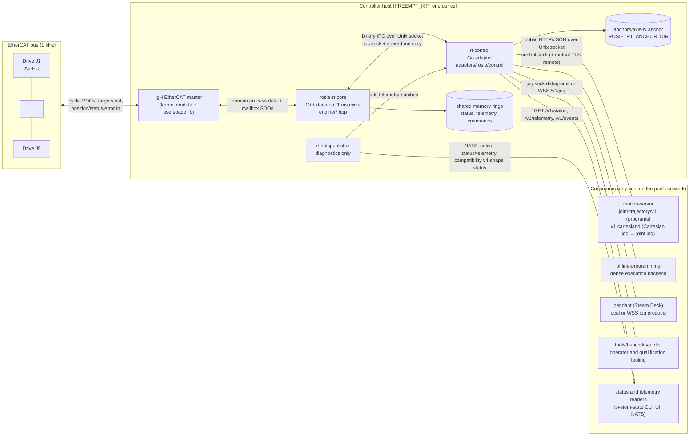
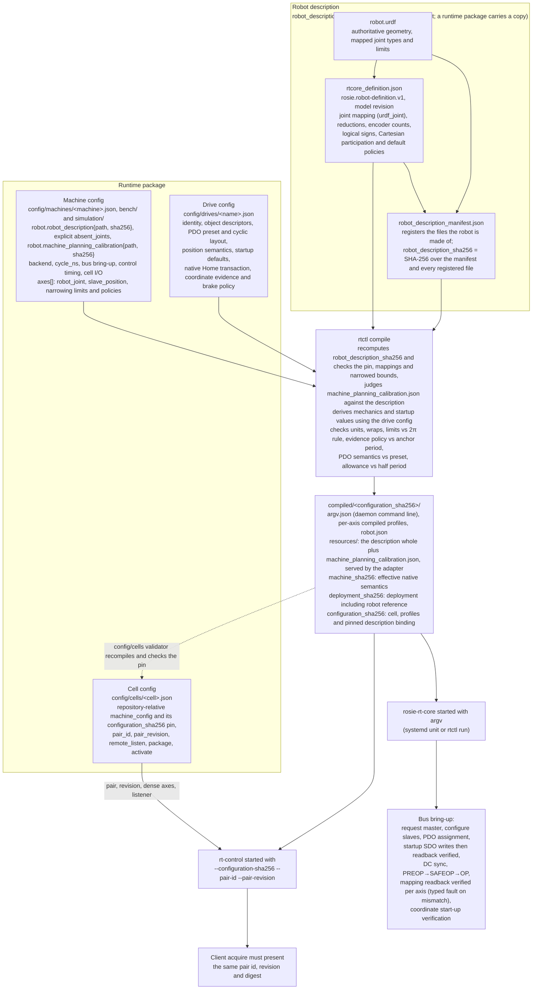
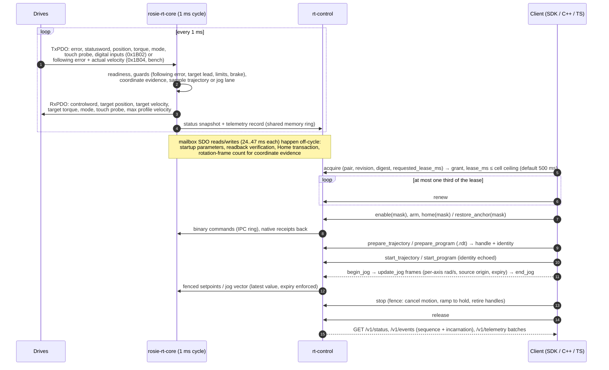
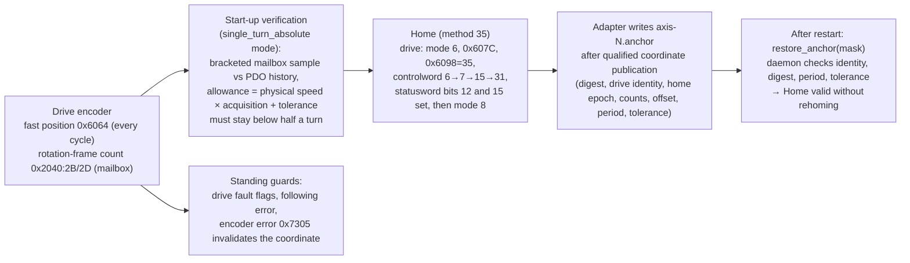

# rt-core: how it all connects

One page for the whole picture: the processes, what talks to what, what flows every
millisecond versus on request, and how a robot or bench is described and loaded. The
detailed contracts live in [APPLICATION_API.md](APPLICATION_API.md) (public API),
[ARCHITECTURE.md](ARCHITECTURE.md) (internals), [TELEMETRY_RING.md](TELEMETRY_RING.md)
(what every 1 kHz record carries) and [CONTRACTS.md](CONTRACTS.md) (rules
with their regressions). How the offline-programming app finds and controls a cell
is in [offline-programming CELL_CONNECTION.md](../../offline-programming/v1/docs/CELL_CONNECTION.md). Diagrams are Mermaid; GitHub renders them inline.

## 1. Processes and connections

Rules the picture encodes:

- The daemon owns the bus and has exactly one client, the adapter. Nothing else can
  reach the drives.
- The adapter is the only public surface. Every motion-capable request needs a lease
  (acquire, renew, release) bound to the pair identity and the configuration digest;
  Stop is a fence that works even from an expired session.
- The daemon is joint-space only. Cartesian intent is resolved upstream (motion server)
  into per-axis joint velocity before it reaches the jog lane.
- The publisher observes; it never commands.

## 2. Configuration: how a robot or bench is described and loaded

Layer names are drive, robot, machine and cell config ([config/README.md](../config/README.md),
P8-26); the earlier `profiles/` and flat `cells/` layouts are gone. A cell config
pins a machine config's compiled digest and deployment fields; it does not enter
the compiler digest.

The compiler reads the description from the component when it carries
`robot_description/` (a runtime package stages every description, exactly the
files each manifest registers) and from the repository the component sits in
otherwise; the pin is recomputed over the files either way, so the two copies
cannot quietly differ. `verify-package.sh` recomputes every packaged
description's identity against the package manifest.

Machine configs cannot override gearing, sign, wire counts or startup objects. With A6
native gearing, the definition supplies the drive's startup reduction and the
software ratio stays 1. Home calibration remains separate, with its own epoch and
persisted anchors. Migrating a flat machine config preserves native payloads and machine
identity but changes configuration and deployment identity, requiring one Home;
the previous digest directory and its evidence stay untouched. See
[Robot definitions](MIGRATION.md#robot-definitions) for layer ownership, provenance
and the update-path table.

## 3. What flows, and how often

Freshness rules: jog frames carry the input-capture time and an expiry; the daemon
scales frames above the per-axis cap and treats a stalled producer as expired within
the cell's input-age ceiling (default 250 ms, published by Describe). A program's first point must equal the held target within
one count. The lease expiring or Stop arriving inhibits outputs before any further
setpoint.

Each cycle publishes one fixed V2 capture after bus submission. The ring copies
the existing feedback and decision state: signed raw torque and mapping/freshness
validity, position/targets/drive velocity/following error, watchdog counters and
peaks, coordinates/epochs/Home/brake/DS402/slave state, extended diagnostics,
motion sample and authority generations, fault masks, signed wake lateness,
submission result and configured cell I/O words. No additional PDO, SDO or ioctl
read is introduced. `work_ns` includes record publication. The ring, commissioning
`cycle-capture.jsonl`, offline `rtctl telemetry dump-to-jsonl`, HTTP batches and
NATS binary batches preserve the same cycle timestamp and values. Optional field
validity must be checked before replay. V1 dumps are refused with stored/expected
digests and require the matching old converter. The measured V2 layout and bounds
are in [telemetry publication](APPLICATION_API.md#telemetry-publication).

## 4. Coordinates, Home and anchors

## 5. Where the consumers stand (2026-09-18)

| Consumer | Path to rt-core | Selection today |
|---|---|---|
| motion-server joint-trajectory/v1 | rt-core backend through the public C++ client (prepare/start program) | `rt_core` only; any other backend is refused `backend_retired` |
| motion-server v1 cartesiand | `--backend rt_core`: Cartesian intent → joint velocity → jog lane (P6-16 verified) | `rt_core` only; legacy selections refused |
| offline-programming | `rt_core` dense execution backend (Go SDK) and local simulation jog | `rt_core` only; `legacy_v4` refused |
| pendant (Steam Deck) | deploy profile `rt_core.pendant` (endpoint, PKI, principal, pair, digest); Cartesian resolution stays in motion-server/v1; jog frames per P6-07 (merged) | native selection; cell acceptance per tracker |
| system-state CLI | native telemetry, status, events | migrated |
| other readers | compatibility v4-shape status/telemetry from rt-natspublisher | v4-shape through the observation-only publisher |
| bench tooling | benchdrive, rtctl, direct on the public API | rt-core |

`robot/v4/realtime-core` and the legacy selections were retired by P8-11 (`01a2ee4b`,
verified). Installed v4 cells keep their published release tarballs
for rollback and await approved native configurations; see
[Repository defaults and deployed cutover](MIGRATION.md#repository-defaults-and-deployed-cutover).
`dev-stack.sh` accepts only `DEV_STACK_BACKEND=rt_core`.
