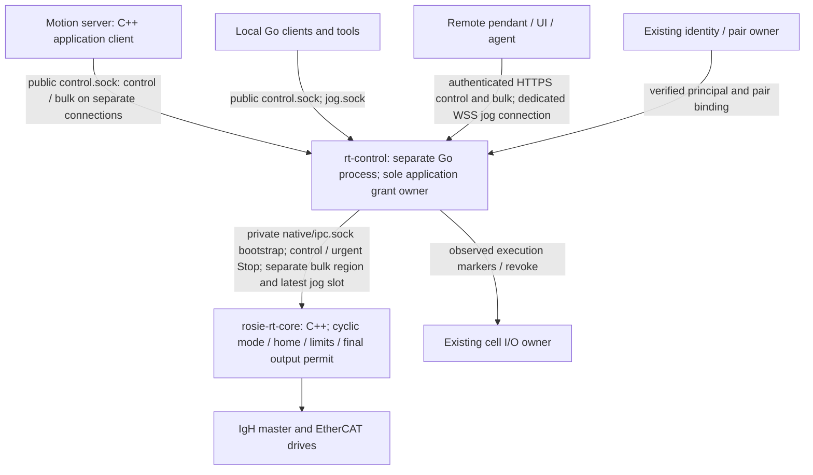

# RT-core kickoff decisions and first milestone

**Status at `403063dc`.** P3-02/P3-05/P3-08 implement independent jog ingress, commissioning/bulk workers and local/WSS jog; P7-02/P7-06 implement service provisioning and mutual TLS; P1-01/P5-01 provide two schemas and generators (C++, Go and TypeScript), with jog records in protocol/control.json. P4-05 public `halt` and the shared ramp are verified; P6-03 principal binding is merged with acceptance pending; the Python oracle named below was removed by P1-10 and `robot/v4/realtime-core` by P8-11. The body preserves the decision checkpoint, including superseded three-schema, Python-oracle and unimplemented-endpoint wording; current topology is in [ARCHITECTURE.md](ARCHITECTURE.md).

Accepted design direction, 2026-09-12; implementation remains open. No work-duration
estimates are used. tracker.html carries work-package status,
role owners, dependencies and evidence. Phase numbers are categories, not order:
**P0 minimum decisions → P2 corrections → P3 lanes → P1 parity/port → P4/P5
incremental completion → P6/P7 integration/package → P8 cutover**.

## Processes, sockets and authority

Target socket names are under `/run/rosie-rt-core/`:

| Surface | Owner and permitted clients | Transport |
|---|---|---|
| `control.sock` | Go `rt-control`; authorized local applications, including the C++ motion server | HTTP over Unix stream socket; dedicated connection pools for bulk, lifecycle and urgent cancellation/renewal. No shared whole-upload writer lock. |
| `jog.sock` | Go `rt-control`; authorized local jog producers | Unix datagram socket; generated bounded frames, credential/grant checks, sequence/expiry checks and latest-value admission. |
| Configured remote listener | Go `rt-control`; authenticated paired principals | HTTPS for control/bulk; dedicated WSS connection for jog, independent of bulk and lifecycle connections. No NATS queue or per-update request/response for jog. |
| `native/ipc.sock` and negotiated native regions | C++ daemon; only `rt-control` in normal operation | Private Unix bootstrap/control socket; separate bounded control, bulk preparation, latest-value jog and status regions, plus urgent Stop/revoke. |

The adapter stays a separate process. It authenticates and grants one expiring
application session; native independently enforces its mirrored capability,
generation and lease every cycle. This is one grant with native enforcement,
not two independent application authorities. The C++ application client never
acquires directly from native IPC. Exclusive maintenance/test access requires the
adapter released, motion inhibited and a distinct privileged procedure.

The native reader must not block behind network work, allocation, codecs or
mailbox SDOs. The cell I/O owner stays separate. Socket access and incarnation
fencing are P7 deliverables; none of these new endpoints is claimed implemented.

## Jog transport and clock decision

Use one dedicated authenticated WSS jog connection for remote producers. This
works for a browser UI and a native pendant through the same admission owner.
Connection identity is bound to the existing principal/pair grant; reconnect
requires a fresh jog session. Local native producers can use `jog.sock`.

The sender retains at most one unsent update, replacing it with the newest;
receivers bound message size/queues and admit the newest valid sequence. Do not
replay queued input after a stall or reconnect. A congested reliable connection
can delay frames: source-age rejection and native expiry must stop that becoming
late motion. Qualify this transport against the declared input-age budget under
loss/congestion; failure to meet it blocks remote-jog release and requires an
explicit design revision, not a relaxed freshness threshold.

Use monotonic source time plus source clock incarnation. The authenticated
connection performs timestamp exchanges to estimate a conservative interval for
source-to-adapter clock offset, including round-trip uncertainty and drift. If
adapter time equals source time plus an offset in [lo, hi], use the earliest
possible origin (source time + lo) to compute worst-case age and expiry. Reject
when that age exceeds the budget, the entire time interval is implausibly future,
or uncertainty/age of calibration exceeds its limit. Native receives a deadline
in the host monotonic domain that may only be shortened. Same-host clients still
negotiate clock domain/incarnation explicitly. No wall-clock synchronization is
assumed; keep sequence and session checks even with a valid clock estimate.

P0 defines units and measurement points; P3 records measured bounds and rejects
unqualified clock mappings. This is not a hard realtime network guarantee.

## R21: chosen motion policy

This table is the target behavior to implement and test, not permission to
silently change today's fault behavior during a localized P2 fix. New controlled
halt/limit governing must pass simulation and machine-specific stopping
qualification before enabled-hold behavior is used on hardware. Until then retain
current inhibition and report that the capability is unqualified.

| Condition | Decision | Permit, recovery and operator observation |
|---|---|---|
| Valid jog exceeds configured velocity cap | Scale the velocity vector to the effective cap; apply qualified acceleration limits. | Remain in jog; expose requested/applied velocity and `velocity_limited`. A slider overshoot alone does not disarm. |
| Jog approaches a soft position boundary | Govern speed using the qualified stopping envelope; reach zero before the boundary. At the boundary refuse outward travel, permit a new inward request. | Hold with enable only while authority, home, feedback and drive health remain valid; expose `position_limited`. Scale coordinated velocity together, not independent planned axes. |
| Jog approaches target-lead bound with valid tracking | Govern accumulation/speed before the bound and ramp to zero if needed. | Expose `lead_limited`; never clamp an already emitted position discontinuously. An actual hard bound violation follows the fault rule below. |
| EndJog or input expiry with valid authority/feedback | Cancel the jog generation and perform the qualified bounded halt, then hold. | Require a fresh BeginJog to move again; expiry cannot resume on a late update. If halt is unavailable or fails its bound, inhibit and report the fault. |
| Malformed/nonfinite/out-of-range encoding, stale sequence or wrong identity | Reject the whole update; do not refresh input or control expiry. | Existing valid input can run only until its original deadline. Report the rejection; no automatic home invalidation for a rejected packet. |
| Invalid/discontinuous/out-of-limit prepared plan | Reject before activation; no silent bridge or per-axis retiming. | Preserve existing valid mode and home evidence. Return axis/sample/reason for replanning. |
| Stop, grant expiry/revoke, or authority connection loss | Urgent cancellation, generation fencing and output inhibition; request cell I/O OFF through its owner. | Fresh authority/Enable/Arm required. Do not promise physical standstill from a submitted frame. |
| Missing a current complete full-group exchange after bus readiness was established | Retain zero consecutive-miss tolerance: inhibit immediately, invalidate configuration/Home evidence and latch readiness fault. | Explicit verification/reset and qualified coordinate/Home recovery are required. Measure frame-loss rate and recovery on the bench before G1. A future bounded tolerance is a separate policy change; cached WKC is never current feedback. Initial startup without established readiness remains distinct. |
| Hard limit/target-lead violation, following-error timeout, drive/bus fault, or execution deadline miss | Latch typed fault, cancel and inhibit; report failed/unknown bus submission accurately. | Explicit ResetFault and readiness required. No automatic replay or fallback motion. Physical stop/brake chain remains machine-specific. |
| Reset after rejected input or non-motion admission error | No blanket reset or re-home is needed; correct the request. | Preserve valid coordinates/home. |
| Reset after execution fault with continuous trustworthy position feedback and unchanged identities | Clear only the applicable fault after its cause is gone; reconcile held target to valid observed position before re-arm. | Preserve home only where the position evidence remained valid. Reset itself never starts motion. |
| Lost/ambiguous position, wrap, drive replacement, incompatible config, failed home or unobserved disabled motion | Invalidate affected coordinate/home evidence. | Qualified absolute reconciliation or re-home is required; never restore from a guessed anchor. |
| Disable, fault, Stop or lease loss on an axis with a holding brake | Normal disable may use a qualified engage-before-torque-removal sequence. Urgent Stop, fault and lease revocation inhibit immediately; their response must never wait for brake confirmation. Release on re-arm only after qualified enabled holding. | Profile-specific sequencing and observed brake state belong to P4-10. Unexpected disabled motion is a suspected brake failure and also requires coordinate/home-validity assessment. A submitted Stop frame does not prove brake engagement. |

Fault decisions apply to the controlled group. Define per-axis physical brake/STO
behavior in the qualified machine profile. A software limit governor never
weakens the final native hard-limit/output permit checks.

Brake qualification must cover the physical fail-safe response to power or bus
loss, when software cannot deliver another command. The profile must distinguish
a holding brake from a brake rated for dynamic stopping and define the required
standstill evidence, sequencing and failure response. Software alone cannot
promise zero sag. Do not enable a gravity-loaded axis before this physical chain
is qualified; coordinate reconciliation does not replace that requirement.

## Additional decisions from the independent review

Written 2026-09-12 by the independent review of `3fb4fc0`; recorded as Built in
the tracker; the owner accepted all four on 2026-09-14 (GradientOS stays the copied parent, with improvements looked for on every cross-copy). Each is the recommended answer; if the
owner decides otherwise, change the text here and the tracker item, not the plan.

**GradientOS relationship (P0-08).** The fork is permanent. There is no automated
sync in either direction. When a fix is worth carrying across, it is cherry-picked
by hand and recorded in PROVENANCE.md with the source commit. This keeps the
clean break the owner asked for without losing track of shared lineage.

**Schemas and generators (P0-09).** Decision 3 requires one canonical schema for
each wire format. There are three wire formats, so there are three schema files and one
generator per format, each emitting Go and C++ types with golden-byte fixtures:

| Format | Schema | Generator and consumers |
|---|---|---|
| Private adapter-to-daemon binary IPC | `protocol/control.json`, extended incrementally | `go run ./tools/protocolgen`; `rt-control`, native daemon and test harnesses |
| Public HTTP/JSON control and bulk API on `control.sock` and the remote listener | `protocol/application-v1.schema.json`, versioned successors as needed | Planned `go run ./tools/apigen`; Go SDK, C++ motion-server client and tools |
| Jog frame on `jog.sock` and the WSS lane | `protocol/jog.json`, fixed binary frame contract | Planned `go run ./tools/joggen`; Go SDK, pendant/UI/agent producers and `rt-control` |

Only the native schema/generator exists at this checkpoint. The other paths name
the agreed deliverables; their contracts and generated code remain P3/P5 work.

The C++ motion-server client uses generated types for the public API; no
hand-written JSON layer.

**Jog transport fallback (P0-10).** The jog ingress contract is transport
agnostic. WSS is the first remote profile because a browser UI cannot send
datagrams. A native pendant on Wi-Fi will see TCP retransmission stalls, which
stale-input rejection turns into dead input rather than late motion; that is safe
but degrades usability. If P3-07 measurement under loss fails the declared budget,
the recorded fallback is a datagram profile (UDP or QUIC datagrams) for native
pendants behind the same admission owner. The freshness threshold is never
relaxed to make a transport pass.

**Language for new test coverage (P0-11).** The existing Python suite is frozen
as the oracle through P2 and P3 and is not extended after M1. New coverage for
the jog lanes, the API and the controller is written in Go against the existing
Go harness that spawns the simulated daemon. This avoids writing Python tests in
P3 that P1 then has to port with parity.

**Remote listener authority (P7-06).** The HTTPS and WSS listener is a new
authentication surface. Before it is exposed, decide whether it verifies the
existing principal and pair credentials or owns a TLS identity, then provision
certificates, rotation and revocation and test rejected and expired credentials.
Decision 2026-09-12 (orchestrator): the listener is an owned mutual-TLS surface.
Reusing the NATS pair credentials would pull the v4 pair-owner code into the
folder-only scope, so it is not chosen. A component-owned CA issues one client
certificate per remote principal; identity is the URI SAN `rosie-principal:<id>`
and pair binding the URI SAN `rosie-pair:<pair-id>`, which must equal the
adapter's `--pair-id`. Revocation is a CRL checked on every handshake; rotation
is reload of the server certificate, key and CRL on modification-time change.
`host/remote-pki.sh` provisions all of it. Binding these principals to the real
pair owner remains P6-03; no unauthenticated request, including Stop, is answered
on the remote listener.

**Brakes (P4-10).** Brake sequencing is a G1 prerequisite for any gravity-loaded
axis. The R21 table above carries the policy row; the drive profile carries the
delays; the GradientOS plan section 4.5 is the design reference.

## First milestone: corrected execution, original regression oracle

**M1 is P2 correctness, not language migration and not powered-bench readiness.**
Its owner role is Native core, with Validation owning the regression evidence.
Named individuals can be assigned in the tracker; role labels are not staffing
claims. Scope is the existing tracker work packages `P2-01` through `P2-12`.

- Preserve the existing Python harness, assertions and fixtures. Add regressions
  for start-before-enable, failed bus send/Stop acknowledgement, disabled-axis
  displacement/re-arm, legacy jog STOP results and prepared-handle Abort.
- Demonstrate each actual defect on code `895e249` using simulator-only fault
  injection where needed, then make the same regression pass on the fix.
  Record a non-reproduced concern as a tested disposition, not a false failure.
- Extract only start/readiness, per-axis output policy and the checked bus seam
  required to test these cases. Defer broader P4/P5 restructuring until green.
- Remove the dead CLI drive-config/default seeding route after call-site tests;
  retire the dead legacy setpoint payload at an explicit ABI transition. Preserve
  its latest-value publication idea for P3, not its obsolete layout.
- Rerun the existing cancellation/continuity/limit/deadline suites and appropriate
  instrumentation. Keep assertions independent of the implementation under test.

**Exit:** failing-baseline/passing-fix evidence for the confirmed defects, a
recorded R04 disposition and unchanged previous regression coverage. P3's full
jog-age/load evidence and G1 host/inhibited checks are still required for motion.

## Later changes and tracker discipline

P3 proves the new lanes using the existing harness. P1 then ports against that
known behavior: compare old and new suites on the same fixed daemon/configuration
and retain the old oracle until parity is demonstrated. Python absence gates G2,
not G0/G1. Do not add new Python product functionality while retaining this oracle.

Define the minimum contracts in P0, generate only the codecs needed by each
implementation increment, and extend the schema with P3/P5 behavior. All owned
C++/Go wire encoders/decoders are generated; no hand-packed second codec. Generated
code does not replace independent golden-byte/negative interoperability fixtures.

P4/P5 proceed by individually tested extractions, not a monolithic rewrite. P4
must address per-axis state-query ioctls in the cycle and replace the optional
fast-trace thread with bounded observations before removing its diagnostic
coverage. P7 must remove helper affinity assumptions about CPUs 0/1 and prove
housekeeping masks exclude the chosen RT CPU within the host's allowed cpuset.

Every completed work package updates the embedded data in `tracker.html`, with
an evidence path/result and implementation commit where applicable, plus the
relevant plan checkbox and validation record. Browser edits are local drafts:
export its data block and commit it to make changes shared.
No scheduled background monitoring or automatic hardware operation is implied.
