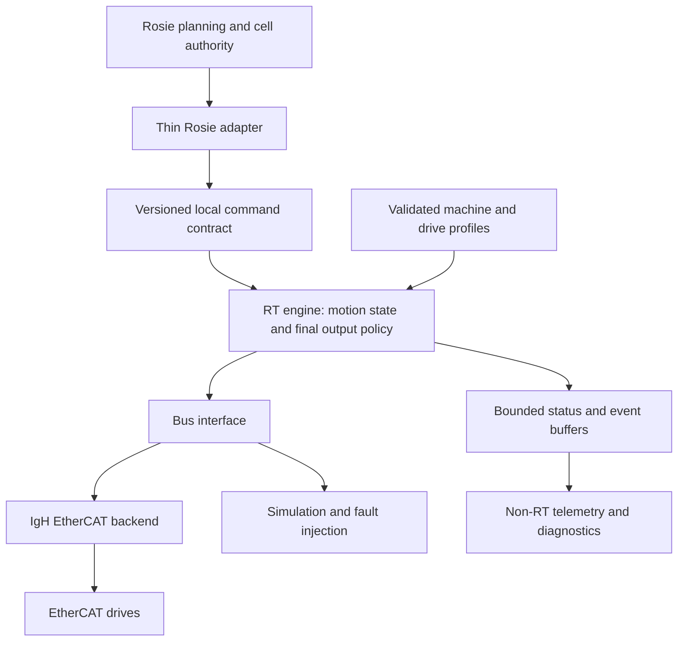

# Standalone RT core architecture review

Historical baseline review. The implementation has since gained immutable plans,
explicit Prepare/Start/Stop results, generic tracking policies, engine modules and
a thin local application service; copied bridge/catalogue code was removed.
The [complete implementation plan](../IMPLEMENTATION_PLAN.md) now records the
2026-09-12 review dispositions against `895e249`, the Go/C++-only requirement and
all remaining software/integration/qualification gates. The
[implemented API](../APPLICATION_API.md) labels current limitations. The findings
below retain their original baseline; they are not the complete current backlog.


Review date: 2026-09-11. Baseline: RosieOS commit `f68e871`, branch
`codex/standalone-rt-core`. This reviews the extraction as implemented, including
code added during the migration. Findings below describe that baseline; subsequent
corrections and remaining work are tracked in [IMPLEMENTATION_PLAN.md](../IMPLEMENTATION_PLAN.md).
The recorded observations are preserved as historical evidence.

**Executive finding:** the extraction is a useful, independently buildable
development base. I would keep Linux realtime support, IgH, buffered position
and velocity execution, and per-axis drive configuration. I would substantially
rework the executor's state ownership, common motion checks and adapter boundary
before migrating Rosie or testing powered movement. Three simulation probes
exposed behavior the existing passing tests did not cover. The full application
migration is also unfinished.

**V4 contains useful engineering that should survive the migration.** Its jog
shaping, feedback-relative target bounds, configuration/authority checks and
physical-output lifecycle deserve deliberate ports and regression tests. Copying
the bridge into this folder has not integrated those contracts with the new core.

## What is actually self-contained?

| Component | Current location and status |
| --- | --- |
| Realtime application | `src/main.cpp`, `include/`: cyclic executor, motion modes, CiA402 sequencing, output policy and telemetry |
| Application integration with IgH | In the same C++ source, with profiles and build scripts inside `rt-core` |
| IgH upstream master source | Pinned fetch/build recipe inside the folder; fetched source and userspace library live under ignored `build/deps`, not in the committed source tree |
| Installed EtherCAT master | Host dependency: library, kernel modules, `/dev/EtherCAT0`, service and interface setup; `host/ethercat-foundation.sh` owns provisioning and verification |
| Realtime Linux kernel | Host dependency, not a kernel source tree or OS image supplied by this folder |
| Rosie application integration | Copied bridge is present, but still uses the v4 UDP/status contract; new native IPC client exists separately |
| Active Rosie deployment | Still selects the previous runtime; composed cutover is pending |

The source/build boundary is independent of the GradientOS and v4 checkouts.
This is **not yet a self-contained RTOS/master distribution or a completed Rosie
replacement**. Earlier descriptions of the extraction need that qualification.
The userspace IgH build helper explicitly passes `--disable-kernel`; its successful
link check does not qualify the installed kernel master.

To make the requested folder the complete owner of the drive-facing platform,
keep its source, profiles, host configuration, dependency locks, licenses,
installation and qualification tests here. Add a reproducible platform manifest
and an optional offline deployment bundle containing the exact IgH sources,
patches and required packages. The kernel and master still install into the host
OS. A pinned image artifact can supply a complete OS without committing an entire
Linux tree to the application repository.

## Confirmed motion findings

Evidence: [recorded observations](review-evidence-2026-09-11.json) and
[simulation probe](../../tools/review_simulation.py). These observations came from
the simulated process image under Ubuntu 22.04/WSL, not physical drives. The
simulator follows emitted position targets, so measured movement here establishes
command-path behavior, not a physical motor response or realtime qualification.

### P1: the public Stop command does not stop a buffered trajectory

The Python `Client.stop()` sends a jog STOP/QUICK_STOP command. The RT handler
clears jog state but leaves `active_trajectory` set. Quick stop is explicitly
excluded while a trajectory is active.

During a ten-second trajectory, the probe issued Stop at 160 encoder counts.
After another 0.8 seconds the simulated axis was at 494 counts: **334 additional
counts**, still armed, with no safety fault. This matches the requested trajectory
continuing. Urgent Disarm is a separate mechanism; this finding does not claim
Disarm failed.

Source: `python/rtcore/client.py:163`, `src/main.cpp:3644`,
`src/main.cpp:4105`.

Required change: define mode-independent Stop, controlled halt, abort and Disarm
semantics. Cancelling must invalidate active and pending motion generations.
Specify the actual output and acknowledgement for each transition, including
trajectory upload, homing, jog and disconnect. Test the public Python/Go APIs,
not just individual jog handlers.

### P1: first-point discontinuity bypasses the configured axis velocity limit

Upload validation checks supplied velocity and the slope between uploaded
points. It does not check continuity from the held/current position to the
first point. The final output check tests velocity feedforward, while position
slew is bounded by the separate motor-RPM setting.

Starting at zero, a trajectory whose first and second positions were both
0.4 rad, with zero feedforward, passed validation. The configured axis maximum
was **0.1 rad/s**. Sampled simulated position advanced at approximately
**1.017 rad/s**, over ten times that limit, without a fault.

Source: `src/main.cpp:1382`, `src/main.cpp:3600`, `src/main.cpp:4231`,
`src/main.cpp:6765`. Fixture: `config/simulation.json`.

Required change: reject a discontinuous starting state or require an explicit,
bounded approach move. Validate the executed position function and its speed
and acceleration, not only feedforward values. All motion modes must pass through
one final output policy. Check limits in logical axis units and preserve
coordinated path timing: independently clamping every joint is not a substitute
for validating or retiming the planned trajectory.

### P2: missed deadlines are counted without an explicit motion response

The steady cyclic loop increments an absolute schedule and counts overruns.
It neither rebases that schedule after a large miss nor defines a lateness
threshold that revokes motion. Past deadlines allow immediate catch-up cycles.
The sleep return value is also ignored.

Pausing the simulated daemon for **80 ms** and resuming it produced **80 overruns**
and about **79.84 ms maximum jitter**. The core remained armed without a safety
fault. This pause was below the local command lease timeout, so that independent
timeout did not protect this case.

Source: `src/main.cpp:3457`, `src/main.cpp:3476`, `src/main.cpp:4784`.

Required change: define a qualified maximum lateness and recovery policy,
prevent burst replay of stale cycles, and test the response during every motion
mode. A drive watchdog may independently react on hardware; its behavior was
not tested and cannot substitute for an explicit application policy.

## Further code and architecture findings

1. **Realtime setup is best effort.** `mlockall` and scheduling/affinity failures
   are warnings. CPU sets are hardcoded. Host tooling checks exact kernel/module
   identity but does not by itself prove PREEMPT_RT configuration or a latency
   budget. Require configured scheduling/memory prerequisites before live Arm,
   expose observed readiness, and qualify CPU/IRQ settings on the target host.
   Sources: `src/main.cpp:2113`, `src/main.cpp:2661`.
2. **The cyclic path does work proportional to the uploaded trajectory.** It
   uses `try_lock`, so it does not block waiting for that mutex, but then copies
   up to 4,096 points inside the cycle. Publish an immutable, preallocated
   buffer by index at a cycle boundary, with explicit lifetime/reclamation.
   Avoid bulk upload copies in cyclic execution. Source: `src/main.cpp:3588`.
3. **State ownership is difficult to audit.** IPC, service and RT paths share
   many independently atomic fields. Individual atomic access does not establish
   a coherent snapshot of an entire state transition. Give the RT engine sole
   ownership of execution state and publish complete versioned observations.
4. **Logging can enter the cyclic path.** `logf` performs formatted stderr I/O;
   cyclic fault/diagnostic paths call it. Use a bounded event ring drained by a
   non-RT worker, with explicit dropped-event counts. Source: `src/main.cpp:156`.
5. **Vendor generalization is incomplete.** The common extended status ABI still
   defines A6 object-dictionary fields. One validity bit covers an axis even if
   only one optional field is mapped. Introduce field-level validity and units;
   isolate vendor diagnostics and coordinate quirks in explicit profiles.
   Sources: `include/ipc_v1.hpp:264`, `src/main.cpp:4290`.
6. **Capability boundaries need definition.** Generic startup SDOs support signed
   and unsigned 8/16/32-bit values, but the service-write ABI remains u16-only.
   The normal cyclic command mode is CSP; configurable PDOs do not establish
   support for every CiA402 motion mode. Declare supported capabilities and gate
   activation on observed drive mode/readiness. Adding Yaskawa must be a verified
   profile/backend exercise, not a manufacturer conditional in trajectory code.
7. **There are too many places to maintain the contract.** C++ wire structs,
   Python packing and Go packing are handwritten separately, and configuration
   passes through a JSON-to-CLI representation. Prefer one versioned schema with
   generated codecs and one immutable validated configuration representation.
   Keep validation at trust boundaries without duplicating business policy.

These are source-review findings, not claims that each has independently caused
an observed hardware failure.

## Features worth salvaging from v4

| Mechanism | Present migration status | General-purpose implementation |
| --- | --- | --- |
| Explicit Arm/Disarm, command freshness and restart invalidation | Local core mechanisms implemented | Retain; verify mode-independent cancellation and application authority binding |
| Configuration generation and exact drive-setting readback | Generic startup verification implemented; pair/robot binding pending | Bind verified settings to machine configuration, drive identity and home generation |
| Jog acceleration shaping | Missing from the new execution path | Configured per-axis acceleration and defined stopping behavior; remove fixed robot values and hardcoded 1 ms arithmetic |
| Feedback-relative jog target lead | Missing from the new execution path | Bound target lead/following error in axis units; specify fault duration and response |
| Home-relative limits and useful limit reasons | Static logical limits/home gate implemented; dynamic enforcement incomplete | One coordinate model and one output policy covering jog, trajectory, hold and home |
| Rotary seam protection | Exact v4 guard not ported | Preserve tested A6 behavior as a profile-specific coordinate policy; do not impose A6 wrapping on linear or other drives |
| Network controller leases, pair configuration and command epochs | Copied bridge code; not connected to the new daemon | Thin Rosie adapter validates remote authority and binds it to a revocable local session |
| Physical I/O lease expiry, weld output shutdown and readback | Copied bridge code; not integrated | Preserve in the cell I/O owner/adapter with real output feedback and shutdown tests |
| Field regression cases and diagnostic evidence | Partly copied; new simulation is simple | Reuse behavioral tests; add delayed feedback, drive faults, lost frames, restart and deadline injection |

Concrete v4 sources: `robot/v4/realtime-core/src/robot_v4_rtcore.cpp:2941`
(target lead), `:2966` (seam hold), `:3000` (velocity slew), and
`robot_v4_rtcore_ethercat_runtime.hpp:1965` (live use). The v4 slew helper snaps
zero/reversal requests to zero; it is not a complete general acceleration and
deceleration policy to copy unchanged.

Persisted absolute-position reconciliation is also still missing. GradientOS
contains useful anchor logic; combine it with configuration, drive identity and
home-generation checks. Required-home axes currently need homing after restart.
Stored gear ratios alone do not establish the PDO coordinate scale: the machine
configuration must describe the counts actually sent to and read from each drive,
including electronic gearing already applied there.

## How I would build it

I would use a small native axis executor on qualified realtime Linux with IgH.
I would retain useful existing code and regression knowledge, while replacing
the monolithic control flow with explicit state ownership and interfaces.
Writing a new kernel or EtherCAT master has no demonstrated benefit here.



The cyclic thread should read bus feedback, consume a bounded command batch,
advance explicit motion/drive state machines, enforce the final output policy,
write the bus, and publish an observation. No parsing, file I/O, synchronous
logging or bulk trajectory copying belongs in that cycle. Upload validation,
configuration preparation and diagnostic formatting run outside it. Stop/disarm
must have a bounded path even during upload or commissioning work.

Keep engine execution identical for IgH and simulation. Compile profiles into
fixed descriptors before starting cyclic operation. Common axis state should
describe position, velocity, optional effort and observed readiness in explicit
units; individual modes and optional diagnostics require declared capabilities.
Do not add a dynamic plugin framework merely to support another manufacturer.

Suggested ownership under the requested root folder:

```text
rt-core/
  engine/                motion, coordinates, state and output policy
  bus/igh/               IgH lifecycle and process image
  bus/sim/               same bus contract with fault injection
  drives/                CiA402 logic and explicit profile quirks
  profiles/              verified drive descriptors
  config/                machine topology, units and limits
  protocol/              versioned schema and generated codecs
  adapters/rosie/         narrow Rosie authority/command/status translation
  platform/              pinned Linux/IgH host requirements and verification
  tools/                 commissioning and deployment
  tests/                 unit, integration, fault and bench contracts
```

These are module boundaries, not a recommendation for many daemons or services.
One RT process and a non-RT adapter/worker arrangement is sufficient until a
measured requirement calls for more.

This separation follows IgH's distinction between configuration/blocking work
and bounded cyclic APIs. PREEMPT_RT also has kernel and hardware requirements
that application source packaging alone cannot satisfy. See the primary
[IgH API usage documentation](https://docs.etherlab.org/ethercat/1.6/doxygen/apiusage.html)
and [Linux realtime documentation](https://www.kernel.org/doc/html/latest/core-api/real-time/index.html).
The online IgH documentation currently describes 1.6.12; implementation changes
must be checked against the pinned 1.6.9 headers/source as well.

## Bloat and cleanup

At the reviewed commit, tracked `rt-core` files total about **49,246 lines**,
including documentation, assets and tests. The executor is **7,370 lines in one
file**. The copied Rosie adapter contributes **16,390 source/asset lines** and
**13,637 test lines**, with additional supporting Go packages elsewhere.

Those are source-tree measurements, not binary size or runtime performance
measurements. The copied Go bridge is not linked into the C++ RT executable.
Tests are useful assets, not automatically bloat.

Reduce duplicated ownership: keep URDF/catalog management, planning, diagnostic
tours and cell workflow policy with their Rosie application owners. Reduce the
adapter to command/authority/status translation and explicitly owned I/O
contracts. Retain transitional code until its replacement passes the relevant
tests, then remove the copy and the retired v4 dependency. Avoid maintaining two
complete application stacks in this folder indefinitely.

Split the C++ engine around state ownership and timing responsibilities; merely
moving chunks of the current function into headers will not solve the coupling.
Keep useful bounded capacities. Avoid parallel legacy/new configuration APIs
once the adapter migration permits one canonical contract.

## Recommended sequence and acceptance

1. Turn the three reproduced behaviors into regression gates and fix Stop,
   first-point continuity/output speed limits and deadline handling. Add jog
   acceleration and feedback-lead policies with tests in absolute axis units.
2. Establish a single execution-state owner, coherent snapshots and immutable
   buffer handoff; remove cyclic logging and make RT prerequisites observable.
3. Complete profile capabilities, coordinate/absolute-anchor behavior and
   field-level telemetry validity. Use mixed synthetic profiles to expose hidden
   A6 assumptions; defer the actual Yaskawa profile until model/ESI are known.
4. Replace the copied v4 transport with the native client in a thin Rosie
   adapter. Preserve controller, configuration, home and physical-output
   authority. Run composed Rosie tests against the actual new daemon.
5. Produce reproducible host/bundle artifacts, qualify target-host timing and
   drive behavior, then switch deployment ownership and retire v4 dependencies.

Existing unit, sanitizer, Go race and userspace-link results remain useful but
did not cover the three probes. WSL tests, a successful build and simulated
position movement do not qualify realtime deadlines or physical stop behavior.
No physical drive was contacted during this review.
